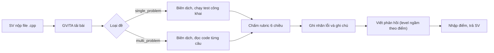
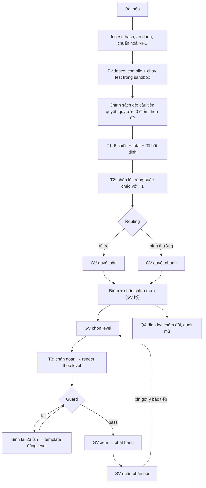

# 01 — Phân tích nghiệp vụ: hệ thống LLM chấm điểm và phản hồi bài lập trình C++

| Trường | Giá trị |
|---|---|
| Phiên bản | 0.1 (nháp để stakeholder review) |
| Ngày | 2026-10-04 |
| Vai trò soạn | Business Analyst |
| Nguồn (theo thứ tự ưu tiên khi mâu thuẫn) | (1) Đề đồ án (toàn văn, 4 trang); (2) [Báo cáo EDA](../plans/reports/eda-261003-2335-sample-dataset.md), đặc biệt §7; (3) [Brainstorm](../../plans/reports/brainstorm-261003-2159-llm-grading-challenge.md) |
| Tài liệu liên quan | SRS (BR/FR/NFR/C/Q), tài liệu scenario/test (SC/TC) — viết sau, trỏ ngược về ID ở đây |
| Dữ liệu đã thấy | Chỉ bộ mẫu 32 bài (EX01 15, EX02 17). README ghi rõ không phải train/test chính thức |

**Quy ước đọc**

- **[CH]** = Hệ thống (1): pipeline của nhóm cho challenge (dự đoán, đánh giá nội bộ, nộp leaderboard, tái lập).
- **[NV]** = Hệ thống (2): bối cảnh nghiệp vụ thật — trợ lý chấm bài cho giảng viên. Dùng cho model card và mục "khả năng triển khai" của báo cáo. Không triển khai thật trong đồ án.
- **[GT]** = giả thuyết, chưa có cơ sở dữ liệu. "EDA §x" = mục trong báo cáo EDA; "BS §x" = mục trong brainstorm.
- ID thuộc tài liệu này: STK, G, KPI, UC, US, RSK, A. Các ID BR/FR/NFR/C/Q thuộc SRS; SC/TC thuộc tài liệu test. Tài liệu này **không** định nghĩa ID loại khác.
- Không trích code sinh viên. Chỉ tham chiếu `sample_id` (ví dụ `EX02-S214`) làm fixture.
- Mọi số liệu trên mẫu có n = 32: CI rất rộng (QWK CI95 rộng khoảng 0.5 — EDA §2.5). Ngưỡng KPI đều là đề xuất, phải hiệu chỉnh lại khi có tập đầy đủ.

---

## 1. Bối cảnh và phát biểu vấn đề

### 1.1 Nghiệp vụ chấm bài lập trình

Mỗi học kỳ, giảng viên (GV) và trợ giảng (TA) các môn lập trình nhập môn chấm hàng nghìn bài nộp. Mỗi bài gồm 3 việc:

1. **Cho điểm** theo rubric 6 chiều: compilable (0–1), io_format (0–1), logic (0–4), edge_case (0–2), complexity (0–1), code_quality (0–1); tổng 0–10.
2. **Chỉ ra lỗi** theo taxonomy 10 nhãn (Lỗi biên dịch, nhập/xuất, logic, vòng lặp, mảng/chuỗi, hàm, edge case, thuật toán, hard-code, style).
3. **Viết phản hồi** tiếng Việt ở mức hỗ trợ phù hợp: L1 gợi ý nhẹ → L2 chẩn đoán → L3 gợi ý sửa → L4 lời giải mẫu.

Hai loại đề dùng chung rubric: **multi_problem** (môn CTDL&GT, nhiều câu trong một file, có trọng số và câu tiên quyết, chỉ có `compile_log`) và **single_problem** (môn CSLT, stdin/stdout, có test công khai và `test_report`).

### 1.2 Nỗi đau (pain points) — có bằng chứng từ dữ liệu mẫu

| Nỗi đau | Biểu hiện | Bằng chứng trên mẫu | Hệ quả |
|---|---|---|---|
| Khối lượng lớn | Hàng nghìn bài/kỳ; bài multi_problem dài (trung vị 140 dòng, 4 hàm) | Đề §1; EDA §5 | Trả bài chậm; phản hồi bị rút ngắn |
| Lệch giữa/trong người chấm | Cùng lỗi, điểm khác xa | Cùng lỗi P1: `EX01-S105` = 2, `EX01-S110` = 8; nhóm "P1 sai" trải 1–9 điểm (EDA §2.4) | Bất công giữa sinh viên (SV); dữ liệu nhãn nhiễu |
| Chấm theo khuôn, mất độ phân giải | Nhiều bài khác nhau nhận cùng một vector | 7/17 bài EX02 cùng vector 112111 dù pass từ 0 đến 6/8 test (EDA §2.1) | Điểm không phản ánh mức hiểu bài |
| Chính sách công bố ≠ chính sách áp dụng | Quy định tiên quyết, trọng số, cấm `main` không được thực thi nhất quán | Gold không áp cổng P1; trọng số 1/4/2/3 vs 2.5×4; 10/15 bài còn `main` không bị trừ (EDA §2.4) | SV không biết luật thật; khó phúc khảo |
| Tiêu chí I/O không minh bạch | In prompt không bị trừ, thừa 1 dấu cách lại bị trừ | `EX02-S211` pass 0/8 vẫn 10/10; `EX02-S205` pass 8/8 mà io_format = 0 (EDA §0.5) | Tiêu chí io_format ngược với harness test |
| Phản hồi thiếu sư phạm | Phản hồi là ghi chú cho người chấm, không phải lời nói với SV | EX01: 0/15 xưng "em", 9/15 gọi "SV", 3/15 dán log; động viên thật 1/32 (EDA §4.4) | SV khó tự sửa; trải nghiệm học kém |
| Mức phản hồi không đúng định nghĩa | L2 đưa cách sửa, L3 thực chất là lời giải, L2 không nêu nguyên nhân | Tuân thủ định nghĩa level 36–61%; `EX02-S207` (L3) áp gợi ý là pass 8/8 (EDA §4.2) | Lộ đáp án hoặc phản hồi rỗng |
| Level do điểm quyết định, không do mục tiêu học | EX01 toàn L2; EX02 L1 ⇔ total = 10; không có L4 | EDA §4.1 | Level không phải quyết định sư phạm có chủ đích |

### 1.3 Phát biểu vấn đề

| | [NV] Nghiệp vụ thật | [CH] Challenge |
|---|---|---|
| **Ai bị ảnh hưởng** | GV/TA môn lập trình nhập môn; SV | Nhóm học viên (5–7 người); GV môn LLM |
| **Vấn đề** | Chấm tốn thời gian, không nhất quán; phản hồi ngắn, sai mức, đôi khi lộ lời giải | Trong 8 tuần, với dữ liệu rất nhỏ (~121 bài [GT], EDA §0.1) và nhãn nhiễu, phải xây pipeline tự động 100%, tái lập được cho 3 task, dưới ràng buộc liêm chính chặt |
| **Tác động** | Bất công, SV học kém hiệu quả, GV quá tải | Rủi ro mất 30% (thứ hạng) nếu không tái lập; mất toàn bộ nếu vi phạm quy chế |
| **Giải pháp thành công khi** | Trợ lý LLM đề xuất điểm, nhãn, phản hồi; GV duyệt và ký. Thời gian chấm giảm, độ lệch AI–GV không lớn hơn độ lệch GV–GV, 0 phản hồi L1/L2 lộ đáp án | Thứ hạng private cao và đều cả 3 task; so sánh ≥1 hướng prompting với ≥1 model open-weight fine-tune (≤10B, chạy local); ablation, phân tích lỗi; ≥2 phát hiện dữ liệu/metric đủ chuẩn bonus |

### 1.4 Khác biệt then chốt giữa hai hệ thống

| Khía cạnh | [CH] | [NV] |
|---|---|---|
| "Sự thật" để tối ưu | Nhãn GV trong dữ liệu (gold), kể cả khi nhiễu | Chính sách chấm đã công bố + phán quyết của GV duyệt |
| Chính sách tiên quyết multi_problem | Dùng làm **feature**, học ánh xạ thật từ gold; báo cáo cả hai điểm vận hành "tối ưu theo gold" và "đúng theo policy" (EDA §7.2.1) | Áp đúng policy; mọi sai lệch hiển thị cho GV quyết |
| Vai trò con người | Không can thiệp từng bài lúc suy luận | Human-in-the-loop bắt buộc; GV ký mọi điểm |
| Nhãn lỗi làm input T3 | Gold cho sẵn (đề §3) | Nhãn T2 **đã được GV duyệt** → lỗi T2 lan sang T3 nếu duyệt lỏng |
| Feedback | CẤM làm input T1/T2 | Phản hồi AI không được quay lại ảnh hưởng điểm |
| Level phản hồi | Cho sẵn trong input | GV chọn theo mục tiêu sư phạm |
| Thước đo thành công | KPI-01…KPI-16 | KPI-17…KPI-24 |
| Rủi ro chính | Tuân thủ quy chế, tái lập, metric nhiễu | Công bằng, lộ đáp án, automation bias, quyền riêng tư |

---

## 2. Stakeholder

| ID | Stakeholder | Hệ | Lợi ích | Mối quan tâm | Ảnh hưởng / Quan tâm | Kỳ vọng | Cách đáp ứng |
|---|---|---|---|---|---|---|---|
| STK-01 | Giảng viên / trợ giảng môn lập trình | NV | Giảm thời gian chấm; điểm nhất quán; phản hồi soạn sẵn | Máy sai mà mình chịu trách nhiệm; mất quyền quyết định; phản hồi lộ đáp án | Cao / Cao | Gợi ý có bằng chứng; chỉ duyệt sâu bài rủi ro; tự chọn level | UC-07…UC-10; routing §9.3; sửa được mọi trường |
| STK-02 | Sinh viên | NV (chủ thể dữ liệu ở CH) | Phản hồi nhanh, đúng mức, dễ hiểu | Công bằng; bị máy chấm; lộ danh tính; phản hồi khó hiểu | Thấp / Cao | Phản hồi xưng hô sư phạm, chỉ ra vấn đề mà không làm hộ; có quyền phúc khảo | Guard level; viết lại văn phong (EDA §7.2.4); GV ký trước phát hành; kênh phúc khảo người |
| STK-03 | Ban tổ chức / GV môn LLM (ra đề, scorer, chấm đồ án) | CH | Đồ án đo được năng lực; phát hiện lỗi dữ liệu/metric | Liêm chính (feedback, test, phát tán); tái lập; định dạng nộp | Cao / Cao | Tuân thủ quy chế; tái lập 1 lệnh; báo cáo đủ mục | Tường lửa feedback; validator; `reproduce`; hồ sơ bonus có timestamp (UC-05) |
| STK-04 | Hội đồng báo cáo | CH | Đánh giá phương pháp và trình bày | Lập luận có cơ sở; ablation; hạn chế trung thực | Cao (25+15+20%) / TB | Slide 15 phút, Q&A 10 phút; số liệu có CI | Bảng ablation có CI; thẻ lỗi theo lát cắt; diễn tập 2 lần |
| STK-05 | Trưởng nhóm — tích hợp, giữ quyền nộp | CH | Điểm đồ án | Tiến độ; quota 2 lượt/ngày; bảng đóng góp | Cao / Cao | MVP xong trước cuối W4; không phí lượt | Gate theo tuần (BS §9); chính sách nộp (UC-02); một người giữ quyền submit |
| STK-06 | Data / EDA / hồ sơ bonus (BS Vai 1) | CH | Bonus +10% | Bằng chứng định lượng đủ mạnh, không claim quá | TB / Cao | Script audit chạy lại trên train chính thức (không chạy trên input test) | `run-eda.sh` (EDA §8); mẫu hồ sơ 8 bước (BS §7) |
| STK-07 | Modeling T1/T2 + fine-tune (BS Vai 3, 4, 5) | CH | Thứ hạng T1, T2 | Dữ liệu nhỏ, nhãn nhiễu, overfit | TB / Cao | Đánh giá nội bộ đáng tin | CV group theo cụm near-dup; bootstrap; chọn theo CV − 0.5·SE |
| STK-08 | T3 và sư phạm — renderer, guard, judge (BS Vai 6) | CH + NV | Thứ hạng T3 | Gold T3 yếu; metric (b) chưa rõ | TB / Cao | Detector compliance đúng nghĩa label_space | Guard đa tầng; judge local có meta-eval |
| STK-09 | Hạ tầng — sandbox, evidence, tái lập (BS Vai 2, 5) | CH | Giữ cổng tái lập | Toolchain khác nhau; UB; cache | TB / Cao | Evidence tái lập được | Docker pin digest; cache theo `code_sha`; chạy máy sạch W6, W7 |
| STK-10 | Quản lý dữ liệu / IT trường | CH + NV | Tuân thủ quy định dữ liệu | Rò rỉ qua API, GPU thuê, AI coding assistant; lưu trữ | Cao (có quyền phủ quyết) / TB | Danh sách "dữ liệu được đi đâu"; on-prem cho NV | Văn bản duyệt ở W1; pre-commit, gitleaks; US-19 |
| STK-11 | Bộ môn / khoa (chủ quản học vụ) | NV | Chất lượng đào tạo đồng đều | Công bằng; trách nhiệm pháp lý của điểm | Cao / TB | Quy trình phúc khảo; báo cáo QA định kỳ | UC-12; model card; KPI-19, KPI-22 |
| STK-12 | Các nhóm khác trong lớp | CH | — | Cạnh tranh công bằng | Thấp / TB | Không chia sẻ code/dự đoán | Chỉ bàn ý tưởng trên diễn đàn; rò rỉ thì báo BTC, không khai thác |

**Lưới ảnh hưởng × quan tâm:** quản lý chặt STK-01, STK-03, STK-05, STK-10; giữ hài lòng STK-04, STK-11; thông tin đầy đủ STK-02, STK-06…STK-09; theo dõi STK-12.

---

## 3. Mục tiêu (G) và KPI

### 3.1 Mục tiêu

| ID | Mục tiêu | Hệ | KPI | UC chính | RSK chính |
|---|---|---|---|---|---|
| G-01 | Thứ hạng private cao và **đều** ở cả 3 task (bảng tổng = trung bình thứ hạng) | CH | KPI-01…KPI-09 | UC-01, UC-02, UC-04 | RSK-05, RSK-15 |
| G-02 | Tuân thủ quy chế tuyệt đối — đây là **cổng**: vi phạm thì mất điểm hoặc không được chấm | CH | KPI-13, KPI-15 | UC-01, UC-03, UC-06 | RSK-01…RSK-04, RSK-12 |
| G-03 | Phương pháp có cơ sở; so sánh công bằng prompting vs fine-tune trên cùng split | CH | KPI-10 | UC-04, UC-06 | RSK-13 |
| G-04 | Ablation đầy đủ và phân tích lỗi "kiểu bài nào, vì sao" | CH | KPI-11 | UC-04 | RSK-15 |
| G-05 | Hồ sơ bonus: vấn đề thật của dữ liệu/metric, có định lượng và đề xuất sửa | CH | KPI-14 | UC-05 | RSK-14 |
| G-06 | Sản phẩm nộp đủ, trình bày thuyết phục | CH | KPI-12 | — | RSK-13 |
| G-07 | Dùng quota leaderboard hiệu quả | CH | KPI-16 | UC-02 | RSK-05 |
| G-08 | Giảm tải chấm cho GV | NV | KPI-17, KPI-18 | UC-07, UC-08 | RSK-16 |
| G-09 | Điểm nhất quán, không kém người chấm | NV | KPI-19, KPI-22 | UC-08, UC-12 | RSK-06, RSK-07, RSK-18 |
| G-10 | Phản hồi sư phạm, đúng level, không lộ đáp án | NV | KPI-20, KPI-21, KPI-23 | UC-09, UC-10, UC-11 | RSK-08…RSK-11 |
| G-11 | Con người quyết định cuối; dữ liệu SV được bảo vệ | NV | KPI-24 | UC-07, UC-12 | RSK-02, RSK-12, RSK-17 |

### 3.2 Nguyên tắc đo trên dữ liệu nhỏ

- Mọi KPI định lượng báo **CI95 bootstrap** (B = 2000, seed cố định) và báo **theo từng exam** cùng số pooled. Gộp exam tạo QWK dương giả: baseline chỉ dùng `exam_id` đạt 0.219 pooled nhưng 0 trong từng exam (EDA §2.5).
- Một KPI chỉ tính là "đạt" khi cận dưới CI vượt mốc, hoặc paired bootstrap của Δ không chứa 0. Không chọn mô hình theo chênh lệch < 0.1 QWK (EDA §7.2.6).
- Không tune theo public leaderboard: F1 của nhãn hiếm dao động ±0.2 chỉ vì 1 mẫu (BS §4.2).

### 3.3 KPI leaderboard [CH]

| ID | KPI | Định nghĩa | Cách đo | Ngưỡng đề xuất |
|---|---|---|---|---|
| KPI-01 | QWK total (T1, chính) | Cohen κ trọng số bậc hai trên `total_score` nguyên, `labels` cố định 0..10 | OOF (CV group theo cụm near-dup) + public dev; pooled và từng exam | Sàn: vượt baseline luật biên dịch cùng split **ở mỗi exam** (mẫu: 0.512 pooled, CI 0.23–0.76; EX01 0.413, EX02 0.636). Đích: pooled ≥ 0.70, mỗi exam ≥ 0.60 [GT] |
| KPI-02 | MAE total | Trung bình \|ŷ − y\| | Như KPI-01; báo ở hai điểm vận hành (tối ưu QWK / tối ưu MAE) | ≤ 1.5 [GT] (baseline mẫu 2.47–2.91) |
| KPI-03 | Exact-match từng chiều và lift | EM từng chiều; lift = EM − EM của mode theo exam | OOF | Lift ≥ 0 ở mọi chiều; luôn báo kèm baseline mode (mode EX02 đã đúng 100% code_quality, 82% compilable — EDA §2.5) |
| KPI-04 | Macro-F1 (T2, chính) | Trung bình F1 trên 10 nhãn cố định | OOF; báo 3 quy ước `zero_division` (0 / 1 / nan) | Thắng baseline "đoán cả 10 nhãn" (0.214) ở cả 3 quy ước; ≥ 0.35 ở zd = 0 [GT]; không nhãn nào thua mốc hằng 2p/(1+p) |
| KPI-05 | Micro-F1 (T2) | F1 gộp TP/FP/FN | OOF | ≥ 0.55 [GT] (luật "CE, ngược lại {logic}": 0.466) |
| KPI-06 | Level compliance (T3-a) | % phản hồi không vượt level. Đo **hai cách**: quy tắc README (L1/L2 không code sửa) và đọc chặt mọi điều cấm của label_space | Guard nội bộ (regex + AST + kiểm thực thi cho EX02) + audit người trên mẫu con lấy từ train/OOF, không bao giờ từ test | Theo README: 100%. Đọc chặt: ≥ 95% [GT]. **Không báo một mình**: output hằng "Tốt." đạt 1.00, cao hơn gold 0.91–0.97 (EDA §4.3) |
| KPI-07 | Độ chính xác chẩn đoán (T3-b) | Trên bài có lỗi: % phản hồi nêu đúng ≥1 lỗi khớp nhãn, với vị trí/định danh có thật | LLM-judge local cố định (có meta-eval với người) + 2 người chấm mẫu con lấy từ train/OOF (không bao giờ từ test), báo κ | Phủ nhãn ≥ 85% [GT] (gold 80–90%, EDA §4.4). Grounding tách 2 chỉ số: (i) diagnoser pass grounding ≥ 95% trước lọc (FR-T3-02); (ii) output cuối có 0 số dòng hoặc định danh không có thật (TC-T3-03). Tương quan judge–người ≥ 0.6 [GT] |
| KPI-08 | Thứ hạng | Hạng từng task và hạng tổng | Public (theo dõi) | Không task nào dưới trung vị lớp; hạng tổng top-3 [GT] |

### 3.4 KPI chấm đồ án [CH] (theo trọng số của đề)

| ID | Hạng mục (trọng số) | Định nghĩa đo | Cách đo | Ngưỡng |
|---|---|---|---|---|
| KPI-09 | Private rank (30%) | KPI-08 trên private test; **chỉ được tính khi KPI-13 đạt** | Công bố ở buổi báo cáo | Như KPI-08 |
| KPI-10 | Phương pháp và thiết kế thí nghiệm (25%) | % mục checklist đạt: ≥1 prompting + ≥1 fine-tune ≤10B local trên cùng split; báo phần cứng, seed, phiên bản; decoder theo metric; learning curve; chế độ "chỉ dùng tín hiệu được cấp" | Review checklist W7 | 100% |
| KPI-11 | Ablation và phân tích lỗi (15%) | % hàng ablation lõi có Δ kèm CI paired bootstrap; số thẻ lỗi theo lát cắt có κ giữa 2 người đọc | Bảng ablation; thẻ lỗi lấy từ train/OOF, không bao giờ từ test | ≥ 80% ở W5, 100% ở W6; ≥ 5 thẻ (FR-RPT-02), κ ≥ 0.6 [GT] |
| KPI-12 | Báo cáo và trình bày (20%) | Đủ 6 mục bắt buộc trong 10–15 trang; model card; slide 15 phút; mỗi mục được 2 người không viết mục đó review | Checklist W7; diễn tập | 100% mục; 2 lần diễn tập |
| KPI-13 | Tái lập và mã nguồn (10%, đồng thời là cổng của 30%) | `reproduce` 1 lệnh trên máy sạch: từ cache thì hash predictions khớp; `FULL=1` lệch trong dung sai; lint/type sạch theo quy ước Python (PY-05, PY-12, PY-13) | Chạy máy sạch W6, W7 | 100% khớp ở cả 2 lần |
| KPI-14 | Bonus (+10%) | Số phát hiện gửi BTC có đủ: claim, bằng chứng (n, %, CI), tác động lên metric, đề xuất sửa, thí nghiệm chứng minh bản sửa | Hồ sơ gửi kèm timestamp | ≥ 2, đích 4; gửi khoảng W5 |
| KPI-15 | Tuân thủ quy chế (cổng) | Số vi phạm: feedback chạm T1/T2, dữ liệu ra ngoài phạm vi, chạm test, can thiệp tay lúc suy luận | Test lineage trong CI; audit repo | 0 |
| KPI-16 | Hiệu quả quota | % lượt nộp hợp lệ; % lượt có lý do hợp lệ theo BS §9 | Nhật ký nộp | 100% / 100% |

### 3.5 KPI nghiệp vụ thật [NV] — toàn bộ ngưỡng là [GT]

| ID | KPI | Định nghĩa | Cách đo | Ngưỡng đề xuất |
|---|---|---|---|---|
| KPI-17 | Thời gian chấm tiết kiệm | (t thủ công − t có trợ lý) / t thủ công, tính cả thời gian duyệt | Pilot đo thời gian: ≥ 2 GV × ≥ 50 bài/đề | ≥ 40% [GT] |
| KPI-18 | Tỷ lệ bài cần người duyệt sâu | Số bài bị routing chuyển duyệt sâu / tổng bài | Log routing | Pha shadow: 100%. Vận hành: ≤ 30% [GT], với điều kiện KPI-19 vẫn đạt |
| KPI-19 | Độ lệch so với GV | QWK, MAE giữa AI và GV, so với giữa GV1 và GV2 trên mẫu chấm đôi mù; % bài \|Δtotal\| ≥ 3 | Chấm đôi mù ≥ 50 bài/đề | QWK(AI, GV) ≥ QWK(GV, GV) − 0.05; \|Δ\| ≥ 3 ở ≤ 5% bài [GT] |
| KPI-20 | Tỷ lệ phản hồi lộ đáp án | % phản hồi phát hành ở L1–L3 vi phạm điều cấm của level. Tiêu chí: SV làm theo mà không cần nghĩ vẫn ra code đúng (BS §4.3) | Guard + kiểm thực thi (EX02) + audit người ngẫu nhiên | L1/L2: 0. L3: ≤ 2% [GT] |
| KPI-21 | Tỷ lệ GV sửa | % điểm / nhãn / phản hồi bị GV sửa trước phát hành | Log duyệt | Giảm dần theo kỳ; điểm ≤ 20% [GT] |
| KPI-22 | Công bằng | Chênh MAE giữa các lát: đề, phong cách code (MSVC/GNU, in prompt, còn `main`), độ dài bài | Báo cáo QA (UC-12) | Chênh ≤ 0.5 điểm [GT] |
| KPI-23 | Hữu ích với SV | Likert "phản hồi giúp em tự sửa"; tỷ lệ cải thiện ở lần nộp sau | Khảo sát + log | ≥ 4/5 [GT] |
| KPI-24 | Kiểm soát của con người và dữ liệu | % điểm phát hành có GV ký; số sự cố dữ liệu | Log | 100%; 0 |

---

## 4. Phạm vi

| | Trong phạm vi | Ngoài phạm vi |
|---|---|---|
| **[CH]** | 3 task trên 2 loại đề (multi_problem, single_problem), C++11; pipeline suy luận tự động 100%; ≥1 hướng prompting + ≥1 model open-weight fine-tune ≤10B chạy local; sandbox biên dịch/chạy code (nếu BTC cho phép, A-06); đánh giá nội bộ (scorer bản sao có unit test); validator và nộp leaderboard; tái lập 1 lệnh; hồ sơ bonus; báo cáo, model card, slide, bảng đóng góp | Gán nhãn tay cho test (kể cả một phần); dùng feedback làm input T1/T2; đọc input test để chỉnh prompt/ngưỡng; sửa tay output; chia sẻ code/dự đoán với nhóm khác; khai thác rò rỉ T2↔T3 hoặc lỗi scorer; kết luận đạo văn (near-dup chỉ dùng để chia CV); truy danh tính; UI production |
| **[NV]** (mức thiết kế khái niệm, cho model card và mục triển khai) | Luồng GV duyệt; quy tắc routing; chính sách chọn level; guard phản hồi; tiêu chí go/no-go; KPI vận hành | Triển khai thật; tích hợp LMS; tự động chốt điểm không có GV; phát hiện gian lận/đạo văn; xếp hạng hay profiling SV; ngôn ngữ/môn khác |

**Giả định phạm vi dữ liệu:** chỉ 2 đề EX01/EX02 như mẫu [GT, A-02]. Nếu dev/test có đề mới, các thành phần phụ thuộc đề (kNN, quy ước theo exam ở EDA §2.2) phải có đường fallback.

---

## 5. Quy trình AS-IS và TO-BE

### 5.1 AS-IS — giảng viên chấm thủ công [NV]

| Bước | Vấn đề | Bằng chứng |
|---|---|---|
| Biên dịch/chạy | Môi trường GV khác môi trường sinh log; kết quả test phụ thuộc toolchain khi code có UB | `EX01-S109` lệch dòng giữa feedback và log; 3/13 chương trình cho kết quả khác nhau giữa clang và gcc (EDA §5) |
| Chấm rubric | Chính sách tiên quyết áp không đều; io_format không theo harness; chấm theo khuôn 3 bậc | EDA §2.1, §2.3, §2.4 |
| Ghi nhãn | Nhãn "Lỗi edge case" không được dùng (0/32); nhãn style/thuật toán không trùng bài nào với chiều rubric tương ứng | EDA §3.1, §3.2 |
| Viết phản hồi | Văn phong ghi chú; level không đúng định nghĩa; L3 lộ lời giải | EDA §4.2, §4.4 |
| Trả bài | Không có kênh xin gợi ý thêm theo nấc | — |

### 5.2 TO-BE — trợ lý AI + người duyệt [NV]

### 5.3 Vòng đời một bài nộp qua 3 task — [CH] so với [NV]

| # | Bước | Input → Output | [CH] challenge | [NV] nghiệp vụ |
|---|---|---|---|---|
| 1 | Ingest | sample JSON + `code_file` → bản ghi chuẩn (NFC, hash) | Input test chỉ được giải nén bên trong lệnh dự đoán | + ẩn danh, phân quyền truy cập |
| 2 | Evidence | code + `compile_log` (+ `test_report`) → evidence card | Tự build gcc trong Docker; cache theo `code_sha` để tái lập (EDA §7.1 D11) | Chạy online có timeout; stdout thô và returncode được giữ |
| 3 | Chính sách đề | `statement`, `grading_policy` → problem card | Là feature, không áp cứng (EDA §7.2.1) | Áp đúng policy; lệch với lịch sử → cảnh báo GV |
| 4 | T1 chấm rubric | đề + code + evidence → 6 chiều + total | Decoder theo QWK; total = Σ6 chiều (32/32, EDA §2.1); quy ước lỗi biên dịch theo đề (EDA §2.2) | + độ bất định cho routing |
| 5 | T2 nhãn lỗi | như T1 (+ total dự đoán) → tập nhãn | Ràng buộc chéo T1↔T2 (EDA §3.2); **CẤM** feedback | Như CH; GV duyệt |
| 6 | Duyệt | — | **Không có** (tự động 100%) | GV ký điểm và nhãn |
| 7 | T3 phản hồi | đề + code + nhãn + level → phản hồi tiếng Việt | Nhãn = gold cho sẵn; level cho sẵn; không có `test_report` (EDA §4.5) | Nhãn = nhãn đã duyệt; level do GV chọn |
| 8 | Đầu ra | → predictions / bản phát hành | Validator → `predictions.json` → leaderboard | Phát hành cho SV; log cho QA |

---

## 6. Use case

| UC | Tên | Hệ | Tác nhân chính | KPI liên quan |
|---|---|---|---|---|
| UC-01 | Chạy dự đoán private test bằng một lệnh | CH | STK-05 | KPI-09, KPI-13, KPI-15 |
| UC-02 | Kiểm định dạng và nộp leaderboard public | CH | STK-05 | KPI-08, KPI-16 |
| UC-03 | Tái lập kết quả cho giảng viên kiểm | CH | STK-03 | KPI-13 |
| UC-04 | Đánh giá nội bộ và chọn cấu hình nộp | CH | STK-07, STK-08 | KPI-01…KPI-07, KPI-11 |
| UC-05 | Lập và gửi hồ sơ phát hiện dữ liệu/metric | CH | STK-06 | KPI-14 |
| UC-06 | Huấn luyện có tường lửa feedback | CH | STK-07, STK-08 | KPI-10, KPI-15 |
| UC-07 | Nạp lô bài và sinh điểm/nhãn gợi ý | NV | STK-01 | KPI-17, KPI-18 |
| UC-08 | GV duyệt điểm và nhãn gợi ý | NV | STK-01 | KPI-19, KPI-21, KPI-24 |
| UC-09 | GV chọn level phản hồi | NV | STK-01 | KPI-23 |
| UC-10 | Sinh, kiểm duyệt và phát hành phản hồi | NV | Hệ thống, STK-01 | KPI-20, KPI-21 |
| UC-11 | SV nhận phản hồi theo level | NV | STK-02 | KPI-23 |
| UC-12 | Kiểm định chất lượng và công bằng định kỳ | NV | STK-11 | KPI-19, KPI-20, KPI-22 |

#### UC-01 — Chạy dự đoán private test bằng một lệnh [CH]
- **Tác nhân:** STK-05 (chính); pipeline; STK-03 nhận kết quả.
- **Tiền điều kiện:** tag `v1.0` đã feature-freeze (W7); lockfile, Docker image digest, model revision, checksum adapter đã pin; cùng lệnh đã chạy trên dev và ra file hợp lệ; BTC đã phát input private.
- **Luồng chính:** 1) Chạy lệnh dự đoán private trên máy chuẩn. 2) Giải nén input test bên trong lệnh, kiểm schema, chuẩn hoá NFC, ghi hash input. 3) Sinh evidence (cache theo `code_sha`). 4) T1 → T2 (ràng buộc chéo) → T3 (chẩn đoán → render → guard). 5) Validator cho cả 3 task. 6) Ghi predictions và manifest (hash input/output, seed, phiên bản, phần cứng, thời gian chạy).
- **Thay thế / ngoại lệ:** 2a Schema khác dev → dừng, báo STK-03, không sửa tay input. 2b Thiếu file `code_file` của một bài → không dừng: bài đó chạy chế độ "chỉ tín hiệu được cấp" với code rỗng, ra fallback hợp lệ, gắn cờ `missing_code` vào audit (FR-ING-03). 3a Sandbox lỗi/timeout ở một bài → gắn cờ, dùng chế độ "chỉ tín hiệu được cấp". 4a Output LLM không parse được → retry theo danh sách seed cố định (≤3) → fallback luật/template đúng level. 5a Validator fail → dừng; sửa **code** rồi chạy lại cả lệnh; cấm sửa tay predictions. 6a Vượt thời gian cho phép → chuyển sang cấu hình nhanh đã kiểm trước.
- **Hậu điều kiện:** predictions hợp lệ cho 3 task; manifest lưu trong repo; không có thao tác tay theo từng bài; không ai đọc input test.

#### UC-02 — Kiểm định dạng và nộp leaderboard public [CH]
- **Tác nhân:** STK-05 (người duy nhất giữ quyền nộp); leaderboard của STK-03.
- **Tiền điều kiện:** định dạng predictions đã được BTC xác nhận (bộ mẫu không mô tả — EDA §1), HOẶC lượt nộp có lý do (iii) đối chiếu scorer/định dạng, dùng biến thể mặc định SRS §6.3; còn lượt trong ngày (2 lượt/ngày, đơn vị là một upload); lượt nộp có lý do hợp lệ: (i) CV cải thiện ≥ max(Δ_min(task), 1 SE) — Δ_min = 0.1 QWK cho T1, T2/T3 chốt ở W2 (Q-33), (ii) hiệu chỉnh quan hệ CV↔LB ở W1–W3, hoặc (iii) đối chiếu scorer/định dạng.
- **Luồng chính:** 1) Chạy dự đoán trên dev. 2) Chạy validator của BTC và validator nội bộ: đủ và không trùng `sample_id`, điểm trong miền, total nguyên = Σ6 chiều, nhãn thuộc 10 nhãn (NFC), `[]` hợp lệ, feedback là chuỗi không rỗng. 3) Ghi nhật ký nộp (run_id, lý do, CV, hash). 4) Nộp. 5) Ghi điểm public, cập nhật quan hệ CV↔LB.
- **Thay thế / ngoại lệ:** 2a Validator fail → không nộp. 4a BTC từ chối file → ghi sự cố, tìm nguyên nhân trước khi dùng lượt kế tiếp. 5a Public lệch CV > 2 SE → không tune theo public; kiểm lại quy ước scorer (`labels`, gộp exam — EDA §2.5).
- **Hậu điều kiện:** lượt nộp hợp lệ, nhật ký đầy đủ cho báo cáo.

#### UC-03 — Tái lập kết quả cho giảng viên kiểm [CH]
- **Tác nhân:** STK-03 (người kiểm); STK-09 hỗ trợ.
- **Tiền điều kiện:** STK-03 được cấp quyền repo private; weights, adapter và cache đã nộp theo kênh BTC chỉ định; README có hướng dẫn cài.
- **Luồng chính:** 1) Dựng môi trường theo lockfile/image. 2) Chạy `reproduce` (mặc định từ cache) → so hash predictions với bản đã nộp. 3) Tuỳ chọn chạy `FULL=1` → so metric trong dung sai ε. 4) Xem log seed, phiên bản, phần cứng, chi phí API.
- **Thay thế / ngoại lệ:** 2a Hash lệch → script diff chỉ ra task, `sample_id` và nguồn lệch (evidence hay LLM). 3a Phần cứng khác → áp định nghĩa tái lập đã thống nhất (khớp argmax hoặc metric ±ε). 3b Không có GPU → chỉ chạy từ cache.
- **Hậu điều kiện:** kết quả được xác nhận tái lập — điều kiện để KPI-09 được tính.

#### UC-04 — Đánh giá nội bộ và chọn cấu hình nộp [CH]
- **Tác nhân:** STK-07, STK-08; STK-05 phê duyệt.
- **Tiền điều kiện:** `folds.csv` đã khoá (group theo cụm near-dup, ví dụ cụm `EX02-S203`…`EX02-S206` — EDA §5; stratify theo exam × khoảng điểm); scorer nội bộ có unit test, `labels` = 0..10.
- **Luồng chính:** 1) Chạy OOF cho từng cấu hình. 2) Tính KPI-01…KPI-07 theo exam và pooled, kèm CI95. 3) So cặp với baseline bằng paired bootstrap. 4) Chọn theo CV − 0.5·SE. 5) Ghi vào bảng ablation (build-up và leave-one-out).
- **Thay thế / ngoại lệ:** 3a Δ < 0.1 QWK hoặc CI chứa 0 → kết luận "chưa phân biệt", giữ cấu hình đơn giản hơn. 2a Nhãn không có support → báo đủ 3 quy ước `zero_division`.
- **Hậu điều kiện:** cấu hình ứng viên kèm bằng chứng thống kê.

#### UC-05 — Lập và gửi hồ sơ phát hiện dữ liệu/metric [CH]
- **Tác nhân:** STK-06; bên nhận STK-03.
- **Tiền điều kiện:** EDA đã chạy lại trên train chính thức (+ dev nếu có nhãn) (EDA §8); không chạy `run-eda.sh` hay `make audit-*` trên input test; đã loại giả thuyết "chấm theo ý định / nương tay" trước khi claim nhãn nhiễu (EDA §6).
- **Luồng chính:** 1) Chọn 2–4 phát hiện theo thứ tự EDA §6: (1) → (2) → (3) → (5). 2) Viết theo mẫu 8 bước (BS §7). 3) Kèm script audit chạy lại được. 4) Gửi BTC kèm timestamp. 5) Đưa vào báo cáo.
- **Thay thế / ngoại lệ:** 1a Số liệu tập đầy đủ không còn ủng hộ → hạ mức hoặc bỏ, ghi vào phần hạn chế. 1b Phát hiện rò rỉ (ví dụ test T2 và T3 chung bài) → báo BTC, không khai thác.
- **Hậu điều kiện:** hồ sơ được ghi nhận, có dấu thời gian.

#### UC-06 — Huấn luyện có tường lửa feedback [CH]
- **Tác nhân:** STK-07, STK-08; STK-06 kiểm tra.
- **Tiền điều kiện:** bảng lineage "artifact nào đã chạm feedback"; loader whitelist trường input theo task.
- **Luồng chính:** 1) Loader T1/T2 chỉ nạp trường được phép. 2) CI kiểm prompt/feature T1/T2 không chứa đoạn trùng feedback (ngưỡng độ dài do SRS chốt). 3) Huấn luyện adapter T1/T2 (không thấy feedback); adapter T3 cách ly hoàn toàn. 4) Ghi seed, revision, phần cứng, GPU-giờ, chi phí API vào sổ.
- **Thay thế / ngoại lệ:** 2a Test lineage fail → chặn merge. 3a Có đề xuất dùng output của model T3 làm feature T1/T2 → từ chối. 3b Dùng API teacher → chỉ khi STK-03 và STK-10 đã cho phép; log token và chi phí từng lần gọi.
- **Hậu điều kiện:** adapter + thẻ lineage + sổ chi phí.

#### UC-07 — Nạp lô bài và sinh điểm/nhãn gợi ý [NV]
- **Tác nhân:** STK-01 khởi động; hệ thống trợ lý.
- **Tiền điều kiện:** đề đã cấu hình (statement, rubric, grading_policy, test công khai); chính sách dữ liệu đã được STK-10 duyệt; hạ tầng on-prem.
- **Luồng chính:** 1) GV chọn đề và lô bài. 2) Hệ thống ghi hash, biên dịch và chạy test trong sandbox. 3) Xác định trạng thái theo chính sách đề (ví dụ câu tiên quyết). 4) T1 sinh 6 chiều, total và độ bất định; T2 sinh nhãn nhất quán với T1. 5) Áp quy tắc routing (§9.3), gắn "duyệt nhanh" hoặc "duyệt sâu". 6) Hiển thị hàng đợi duyệt.
- **Thay thế / ngoại lệ:** 1a Đề mới chưa có dữ liệu hiệu chỉnh → 100% duyệt sâu. 2a Sandbox lỗi → chỉ dùng `compile_log`, gắn cờ. 4a Comment trong code có chuỗi giống chỉ dẫn cho LLM → gắn cờ, duyệt sâu.
- **Hậu điều kiện:** mỗi bài có gợi ý, bằng chứng và trạng thái routing; **chưa có điểm chính thức**.

#### UC-08 — GV duyệt điểm và nhãn gợi ý [NV]
- **Tác nhân:** STK-01.
- **Tiền điều kiện:** UC-07 hoàn tất.
- **Luồng chính:** 1) GV mở bài theo hàng đợi (duyệt sâu trước). 2) Xem evidence card: log, test strict/nới, câu thiếu, cảnh báo chính sách. 3) Chấp nhận hoặc sửa từng chiều và từng nhãn. 4) Ký → điểm chính thức. 5) Hệ thống log diff AI–GV.
- **Thay thế / ngoại lệ:** 3a GV sửa total ≥ 3 điểm → bắt buộc ghi lý do ngắn (dữ liệu cho QA). 3b GV áp ngoại lệ chính sách (ví dụ code viết theo MSVC) → ghi lại như một quy tắc. 4a Duyệt hàng loạt chỉ cho bài "duyệt nhanh", kèm nhắc về automation bias.
- **Hậu điều kiện:** điểm và nhãn chính thức; log phục vụ KPI-19, KPI-21.

#### UC-09 — GV chọn level phản hồi [NV]
- **Tác nhân:** STK-01 quyết định; STK-11 đặt chính sách mặc định.
- **Tiền điều kiện:** nhãn đã duyệt (UC-08).
- **Luồng chính:** 1) GV đặt level mặc định cho lô (ví dụ L2 cho bài kiểm tra, L1 cho bài luyện tập). 2) Hệ thống gợi ý level theo bài (ví dụ bài đạt tối đa → L1 ghi nhận/khen). 3) GV đổi level từng bài. 4) Lưu.
- **Thay thế / ngoại lệ:** 1a Chọn L4 khi bài tập chưa hết hạn → cảnh báo nguy cơ lộ lời giải cho cả lớp, yêu cầu xác nhận. 2a Bài không có nhãn lỗi → chỉ cho phép phản hồi ghi nhận.
- **Hậu điều kiện:** mỗi bài có level đích là **quyết định sư phạm có chủ đích**, không phải hàm của điểm như trên gold (EDA §4.1).

#### UC-10 — Sinh, kiểm duyệt và phát hành phản hồi [NV]
- **Tác nhân:** hệ thống (sinh); STK-01 (phát hành).
- **Tiền điều kiện:** nhãn đã duyệt và level đích (UC-09).
- **Luồng chính:** 1) Chẩn đoán có cấu trúc (lỗi, vị trí, hiện tượng). 2) Render theo level; L1/L2 không nhận thông tin cách sửa. 3) Guard: điều cấm của label_space, so code theo ngữ cảnh (không chỉ so chuỗi con — EDA §4.5), kiểm thực thi gợi ý với EX02. 4) GV xem/sửa. 5) Phát hành.
- **Thay thế / ngoại lệ:** 3a Guard fail → sinh lại (≤3 seed cố định) → template đúng level, gắn cờ cho GV. 1a Chẩn đoán độ tin thấp → nói ở mức chung, không bịa lỗi. 4a GV sửa phản hồi → log cho KPI-21.
- **Hậu điều kiện:** phản hồi đúng level đã phát hành; log guard lưu lại.

#### UC-11 — SV nhận phản hồi theo level [NV]
- **Tác nhân:** STK-02.
- **Tiền điều kiện:** điểm và phản hồi đã phát hành.
- **Luồng chính:** 1) SV xem điểm, nhãn lỗi (theo chính sách hiển thị) và phản hồi. 2) SV tự sửa. 3) [GT, đề xuất mở rộng] SV xin gợi ý bậc tiếp (L1 → L2 → L3) trong giới hạn GV cho phép. 4) Hệ thống ghi nhận.
- **Thay thế / ngoại lệ:** 1a SV không đồng ý điểm → phúc khảo với GV (không phải với AI). 3a Đã tới level trần → từ chối nâng.
- **Hậu điều kiện:** SV có phản hồi; log phục vụ KPI-23.

#### UC-12 — Kiểm định chất lượng và công bằng định kỳ [NV]
- **Tác nhân:** STK-11 chủ trì; STK-01 tham gia chấm đôi.
- **Tiền điều kiện:** ≥ 1 đợt chấm hoàn tất; có mẫu chấm đôi mù.
- **Luồng chính:** 1) Tính KPI-19, KPI-20, KPI-21, KPI-22. 2) Phân tích theo lát cắt. 3) Audit mù 5–10% bài "duyệt nhanh" [GT]. 4) Quyết định chỉnh ngưỡng routing hoặc tạm dừng tính năng. 5) Cập nhật model card.
- **Thay thế / ngoại lệ:** 1a KPI-20 > 0 ở L1/L2 → tạm dừng phát hành tự động L1/L2 tới khi sửa xong. 2a Có drift (đề mới, phong cách code mới) → quay lại 100% duyệt sâu.
- **Hậu điều kiện:** báo cáo QA; quyết định có kiểm soát và có hồ sơ.

---

## 7. User story

Định dạng: "Là …, tôi muốn …, để …" + tiêu chí chấp nhận Given/When/Then. Fixture chỉ ghi `sample_id` của bộ mẫu.

**US-01** [CH] (UC-02) Là STK-05, tôi muốn mọi file predictions đi qua validator nội bộ trước khi nộp, để không mất lượt vì sai định dạng.
- Given file thiếu một `sample_id` hoặc có `sample_id` trùng, When chạy lệnh nộp, Then lệnh dừng, liệt kê `sample_id` lỗi và không upload.
- Given output T2 là `[]` và output T1 có total = Σ6 chiều trong miền, When validate, Then hợp lệ.

**US-02** [CH] (UC-01) Là STK-05, tôi muốn sinh predictions private bằng một lệnh, để tuân thủ yêu cầu "tự động 100%".
- Given tag `v1.0` và input private, When chạy lệnh dự đoán hai lần, Then hai file output có cùng hash.
- Given một bài mà LLM trả output không parse được, When pipeline chạy, Then retry theo seed cố định rồi fallback; pipeline không dừng chờ người.

**US-03** [CH] (UC-03) Là STK-03, tôi muốn chạy lại kết quả tốt nhất chỉ bằng README, để xác nhận tái lập mà không cần nhóm hỗ trợ.
- Given máy sạch có Docker và cache đã nộp, When chạy `reproduce`, Then predictions khớp hash bản đã nộp.
- Given chạy `FULL=1` trên phần cứng khác, When so metric, Then độ lệch nằm trong dung sai đã công bố.

**US-04** [CH] (UC-06) Là STK-06, tôi muốn CI tự chặn mọi đường feedback đi vào T1/T2, để không vi phạm quy chế.
- Given prompt T1 chứa đoạn trùng feedback của một bài train (không trùng code SV), When CI chạy, Then build fail và chỉ ra nguồn.
- Given adapter T3 (đã thấy feedback), When ai đó nối output của nó làm feature T1/T2, Then kiểm tra lineage báo lỗi.

**US-05** [CH] (UC-04) Là STK-07, tôi muốn metric báo theo từng exam kèm CI95 và 3 quy ước `zero_division`, để không bị số gộp đánh lừa.
- Given baseline chỉ dùng `exam_id` trên 32 bài mẫu, When tính QWK, Then báo pooled 0.219 và từng exam = 0 (EDA §2.5).
- Given scorer nội bộ, When tính QWK, Then dùng `labels` = 0..10; unit test tái hiện cặp 0.931 / 0.738 của EDA §2.5.

**US-06** [CH] (UC-01) Là STK-07, tôi muốn hậu xử lý T1 theo quy ước của từng đề, để bắt đúng các ca cực (QWK phạt bình phương độ lệch).
- Given một bài EX01 có diagnostic error trong `compile_log`, When T1 dự đoán, Then vector 000000 và total 0.
- Given một bài EX02 có diagnostic error, When T1 dự đoán, Then vector 000001 và total 1 (EDA §2.2; cần kiểm lại trên tập đầy đủ).
- Given bất kỳ bài nào, Then total = Σ6 chiều.

**US-07** [CH] (UC-01) Là STK-07, tôi muốn T2 tuân theo ràng buộc chéo với T1, để giảm FP/FN có hệ thống.
- Given T1 dự đoán total < 10, When decode T2, Then tập nhãn có ≥ 1 nhãn (27/27 trên mẫu, EDA §3.2).
- Given log chỉ có lỗi link (`EX02-S214`), When T2 chạy, Then "Lỗi biên dịch" không bị gán cứng; lỗi link chỉ là feature.
- Given model sinh nhãn ở dạng NFD, Then nhãn được chuẩn hoá NFC và map về đúng chuỗi trong label_space.

**US-08** [CH][NV] (UC-10) Là STK-08, tôi muốn guard chặn phản hồi vượt level, để không vi phạm compliance.
- Given level L1, When phản hồi chứa code, nguyên nhân cụ thể hoặc vị trí lỗi, Then guard đánh fail và sinh lại; sau 3 lần dùng template L1.
- Given level L2, When phản hồi nêu cách sửa cụ thể, Then guard đánh fail.
- Given level L3 với bài EX02, When áp gợi ý vào code làm pass toàn bộ test công khai, Then gắn cờ "lời giải trá hình" (ca `EX02-S207`, EDA §4.2).

**US-09** [CH] (UC-05) Là STK-06, tôi muốn mỗi phát hiện bonus có script chạy lại, để BTC kiểm được.
- Given train chính thức (+ dev nếu có nhãn; không bao giờ input test), When chạy `run-eda.sh`, Then sinh lại bảng số của hồ sơ; số khác bộ mẫu được ghi rõ.
- Given phát hiện "gold EX01 không theo policy P1", Then hồ sơ có tỷ lệ bài "P1 sai" mà total > 2, kèm CI, và nêu cách đã loại giả thuyết "chấm theo ý định".

**US-10** [CH] (UC-04) Là STK-04, tôi muốn có bảng ablation và thẻ phân tích lỗi theo lát cắt, để đánh giá phương pháp có cơ sở.
- Given mỗi thành phần lõi, When xem bảng ablation, Then có cả build-up và leave-one-out, Δ kèm CI paired bootstrap.
- Given một thẻ lỗi, Then thẻ nêu lát cắt (exam, nhóm điểm, biên dịch, …), số mẫu, nguyên nhân quan sát được và κ giữa 2 người đọc.

**US-11** [CH] Là STK-03, tôi muốn model card nêu rõ dữ liệu, giới hạn và rủi ro khi chấm thật, để đánh giá khả năng triển khai.
- Given model card, Then có: dữ liệu huấn luyện (n, nguồn, chi phí API), metric theo exam kèm CI, các vấn đề nhãn đã biết (EDA §6), rủi ro [NV] (§10), điều kiện human-in-the-loop (§9.3).

**US-12** [CH] (UC-02) Là STK-05, tôi muốn chính sách dùng lượt nộp rõ ràng, để không phí 2 lượt/ngày.
- Given CV cải thiện < max(Δ_min(task), 1 SE) và không cần đối chiếu scorer, When có đề xuất nộp, Then đề xuất bị từ chối và lý do được ghi vào nhật ký.

**US-13** [NV] (UC-08) Là GV (STK-01), tôi muốn thấy điểm gợi ý kèm bằng chứng, để duyệt nhanh và tự tin.
- Given bài EX02 có `test_report`, When mở bài, Then thấy số test pass theo so khớp strict và nới, cờ in prompt/khoảng trắng, cờ crash/timeout, và chiều điểm bị ảnh hưởng.
- Given bài multi_problem, Then thấy trạng thái từng câu (có/thiếu) và cảnh báo nếu câu tiên quyết nghi sai.

**US-14** [NV] (UC-07) Là GV, tôi muốn bài rủi ro tự động vào hàng "duyệt sâu", để không bỏ sót.
- Given bài có lỗi link hoặc 0 dòng code hiệu dụng (như `EX02-S214`), When routing chạy, Then bài vào "duyệt sâu".
- Given hai nhánh dự đoán lệch total ≥ 2 điểm [GT], Then bài vào "duyệt sâu".

**US-15** [NV] (UC-09) Là GV, tôi muốn đặt level mặc định cho lô và đổi từng bài, để phản hồi theo mục tiêu sư phạm.
- Given lô đặt L2, When tôi đổi một bài sang L3, Then chỉ bài đó được sinh lại phản hồi L3.
- Given tôi chọn L4 khi bài tập chưa hết hạn, Then hệ thống cảnh báo và yêu cầu xác nhận.

**US-16** [NV] (UC-11) Là SV (STK-02), tôi muốn phản hồi tiếng Việt đúng mức và xưng hô thân thiện, để tự sửa được mà không bị làm hộ.
- Given level L2, When đọc phản hồi, Then biết lỗi ở đâu và vì sao, không thấy cách sửa hay code.
- Given bài đạt điểm tối đa, Then phản hồi ghi nhận cụ thể điểm làm tốt, không chỉ một chữ "Tốt.".

**US-17** [NV][GT] (UC-11) Là SV, tôi muốn xin gợi ý bậc tiếp sau khi đã tự thử sửa, để học theo nấc.
- Given đang ở L1 và GV cho phép trần L3, When xin thêm, Then nhận L2; tới L3 thì không xin thêm được.

**US-18** [NV] (UC-12) Là STK-11, tôi muốn báo cáo QA định kỳ về độ lệch và công bằng, để quyết định có tiếp tục dùng trợ lý.
- Given mẫu chấm đôi mù, When chạy báo cáo, Then có QWK(AI, GV) so với QWK(GV, GV) theo từng đề, kèm CI.
- Given chênh MAE giữa các lát vượt ngưỡng KPI-22, Then báo cáo đề xuất tăng routing cho lát đó.

**US-19** [NV] (UC-07) Là STK-10, tôi muốn mã nguồn SV không rời hạ tầng đã duyệt, để tuân thủ quy định dữ liệu.
- Given cấu hình triển khai, When hệ thống gọi model, Then chỉ gọi tới endpoint trong danh sách cho phép; mọi lời gọi ra ngoài bị chặn và ghi log.

**US-20** [NV] (UC-08) Là GV, tôi muốn được cảnh báo khi điểm gợi ý mâu thuẫn với chính sách chấm đã công bố, để tự quyết áp hay miễn.
- Given bài EX01 nghi P1 sai mà điểm gợi ý vẫn tính P2–P4, When hiển thị, Then thấy hai con số (theo policy và theo lịch sử chấm) cùng lý do.

---

## 8. Phân tích dữ liệu ở góc nghiệp vụ

Nguyên tắc: **gold ≠ chân lý.** Gold là thước đo của leaderboard [CH] nhưng không phải chuẩn đúng cho nghiệp vụ [NV]. Mỗi vấn đề dưới đây có hai tác động khác nhau và một khuyến nghị riêng.

| # | Vấn đề (EDA §) | Bằng chứng gọn | Tác động [CH] | Tác động [NV] | Khuyến nghị | Bonus |
|---|---|---|---|---|---|---|
| 1 | Gold EX01 không theo chính sách tiên quyết (§2.4, §6 #1) | Cùng lỗi P1: `EX01-S105` = 2, `EX01-S110` = 8; nhóm "P1 sai" 1–9 điểm; `EX01-S112` lặp vô hạn mà logic = 3 | Áp cứng policy làm tụt QWK; policy chỉ dùng làm feature | Hai GV cùng bộ môn lệch nhau → bất công; trợ lý học từ lịch sử sẽ tái tạo sự bất nhất | Hai điểm vận hành: tối ưu theo gold (để nộp) và đúng theo policy (cho báo cáo, cho NV); hỏi BTC | Cao, ưu tiên 1 |
| 2 | io_format ngược harness; `test_report` mất thông tin (§0.5, §2.3, §5) | `EX02-S211` 0/8 → 10/10; `EX02-S205` 8/8 → io = 0; `actual` bị strip; `''` là crash, không có returncode | io_format không học được từ `test_report` thô; cần detector trên stdout thô | Tiêu chí I/O không minh bạch với SV | Tự chạy lại để lấy stdout thô, returncode; hỏi chuẩn io_format chính thức | Cao, ưu tiên 2 |
| 3 | Gold T3 vi phạm định nghĩa level; metric (a) chỉ phạt vượt mức (§4.2, §4.3) | Tuân thủ 36–61%; output hằng đạt 1.00 > gold 0.91–0.97; `EX02-S207` (L3) → 8/8 test | Không SFT thẳng trên gold; tối ưu riêng (a) sẽ ra phản hồi rỗng | Phản hồi thật đang lộ đáp án hoặc thiếu chẩn đoán | Lọc/viết lại gold; level-swap; guard; đo Pareto (a) × (b); đề xuất metric gộp có yêu cầu tối thiểu theo level | Cao, ưu tiên 3 |
| 4 | Nhãn "Lỗi edge case" 0 support + `zero_division` (§3.3) | 0/32 positive; oracle 0.90 hoặc 1.00; P(0 positive ở test) ≈ 0.58 với N ≈ 36 [GT] | Thứ hạng T2 phụ thuộc quy ước scorer | Taxonomy có nhãn không ai dùng → định nghĩa nhãn chưa thống nhất | Báo 3 quy ước; không đoán "Lỗi edge case" trừ khi bằng chứng mạnh; hỏi BTC | TB–cao, ưu tiên 4 |
| 5 | Dữ liệu rất nhỏ, khoảng 121 bài [GT] (§0.1, §7.1 D0) | README nhắc "4/75" và "5/46"; QWK CI rộng khoảng 0.5; bỏ 1 mẫu đổi QWK ±0.05 | Leaderboard nhiễu; không fine-tune head 8B cho T1/T2; learning curve thành thí nghiệm then chốt | Không đủ bằng chứng để triển khai; cần pilot lớn hơn | Dồn fine-tune vào T3 hoặc model nhỏ; mọi số kèm CI; chỉ chọn mô hình khi Δ ≥ 0.1 | Mục hạn chế |
| 6 | `EX02-S214`: file comment toàn bộ được 10/10 (§0.4) | Lỗi link, không có `main`; bản bỏ comment pass 6/8; nhãn T2 chỉ "Lỗi style" | Một điểm nhiễu kéo metric: bắt đúng lỗi link làm luật biên dịch giảm 0.512 → 0.429 | Chấm theo ý định hay theo sản phẩm nộp? | Routing duyệt sâu (§9.3 #2); hỏi BTC có loại khỏi tập đánh giá | Cao (n = 1) |
| 7 | Rubric suy biến (§2.1, §2.5) | EX02: edge = logic/2 (17/17), code_quality luôn 1; EX01: complexity = code_quality = [logic > 0] | Exact-match bị thổi phồng; thực chất chỉ dự đoán 1 biến thứ bậc (logic) | Rubric 6 chiều dùng như thang 3 bậc → phản hồi về điểm mất độ phân giải | Báo lift so với mode; T1 dự đoán logic rồi suy các chiều khác theo ràng buộc | TB |
| 8 | QWK nhạy với `labels` và với việc gộp exam (§2.5) | Pooled 0.219 vs 0 trong từng exam; 0.931 vs 0.738 tuỳ `labels` | Đánh giá nội bộ sai nếu dùng mặc định sklearn | — | Cố định `labels`; báo theo exam | TB |
| 9 | Trọng số EX01 mâu thuẫn; quy định đề không khớp nhãn (§2.4) | 1/4/2/3 vs 2.5 × 4; 10/15 bài còn `main` không bị trừ | Chưa biết ánh xạ kết quả từng câu → rubric | Quy định công bố không được thực thi → SV mất niềm tin | Hỏi BTC; với NV phải đồng bộ metadata đề trước khi dùng | TB–thấp |
| 10 | Input T3 chứa nguyên gold T2 (§0.8) | 32/32, cả thứ tự | Nguy cơ rò nếu test T2 và T3 chung `sample_id`; **không khai thác** | T3 nhận nhãn đã duyệt → chất lượng T3 phụ thuộc chất lượng duyệt T2 | Kiểm mức giao `sample_id`; nếu có thì báo BTC | Có điều kiện |
| 11 | Feedback gold là ghi chú của người chấm (§4.4) | EX01: 0/15 xưng "em", 9/15 gọi "SV", 3/15 dán log | SFT thẳng sẽ học văn phong sai | Phản hồi thật không được viết cho SV | Viết lại sang lời nói với SV (có log chi phí nếu dùng API) | Gộp vào #3 |
| 12 | Level gắn với exam và điểm (§4.1) | EX01 toàn L2; EX02 L1 ⇔ total = 10; luật "exam + total" đoán đúng 29/32; không có L4 | Model dễ học "level = f(điểm)" thay vì theo yêu cầu | Level không phản ánh quyết định sư phạm | Level-swap để lấp L1 cho bài có lỗi và L4; hỏi phân bố level ở test | Gộp vào #3 |
| 13 | Test công khai yếu (§2.3) | 6 True / 2 False; in hằng "True" pass 6/8; `EX02-S208` luôn in True vẫn 7 điểm | Pass rate là tín hiệu nhiễu | Bộ test có thể che lỗi | Thêm test biên làm feature; trên mẫu chưa đổi kết luận bài nào [GT] | Thấp |
| 14 | `compile_log` do BTC sinh lại, có log bị cắt (§5) | `EX01-S109` lệch 1 dòng; `EX01-S111` cắt đúng 2000 ký tự | Chẩn đoán vị trí có thể lệch | — | Tự build bằng gcc 13 trong Docker, cache kết quả | Thấp |
| 15 | Cụm near-dup `EX02-S203`…`EX02-S206` (§5) | Jaccard 0.59–0.95 tuỳ cách chuẩn hoá | CV lạc quan nếu không group theo cụm | Có thể cùng nguồn — **không** kết luận đạo văn | Group CV theo cụm | Không claim |

**Ghi chú diễn giải**

- Trước khi claim "nhãn nhiễu" phải loại giả thuyết "chấm theo ý định / nương tay". Feedback của `EX02-S214` cho thấy GV biết bài bị comment (EDA §6).
- README nhắc trường `compiles_locally` và giải thích "compilable = 1 dù không biên dịch được là do MSVC", nhưng mẫu có 0 ca MSVC và không có trường đó (EDA §5). Chưa đủ để bác bỏ README; ghi nhận như câu hỏi cho BTC.
- Feedback chỉ được đọc cho EDA và hồ sơ bonus; **không** sửa nhãn train theo kết quả đó (BS §2.2).

### 8.1 Bài có `compile_log` không rỗng (10/32)

Nguồn: `task1_grading.json`. Chỉ trích dòng diagnostic, không trích code. Cột "Khớp BR-15" so `log_has_error` (có `error:`, trừ lỗi link) với `compilable` của GV.

**(A) Có lỗi biên dịch hoặc link: 7 bài**

| Sample | Diagnostic chính (g++) | `compilable` GV | Total | Khớp BR-15 |
|---|---|---|---|---|
| `EX01-S103` | `fatal error: ...csv: No such file` (dùng `#include` để nạp file dữ liệu) | 0 | 0 | Có |
| `EX01-S109` | `return-statement with no value` trong hàm trả `Node*` | 0 | 0 | Có |
| `EX01-S111` | `expected primary-expression before ')'`; so sánh `string == int` (log cắt ở 2000 ký tự) | 0 | 0 | Có |
| `EX02-S203` | `redeclaration of 'int dem'`; thiếu `;` | 0 | 1 | Có |
| `EX02-S212` | biến `cnt` chưa khai báo | 0 | 1 | Có |
| `EX02-S214` | lỗi link: `undefined reference to 'main'` | **1** | **10** | Có, vì lỗi link nằm ngoài BR-15; luật đếm cả lỗi link sẽ sai |
| `EX02-S217` | thiếu `;` (dòng 9), kéo theo biến chưa khai báo | 0 | 1 | Có |

**(B) Chỉ có warning: 3 bài, đều được GV cho `compilable = 1`**

| Sample | Warning | Total |
|---|---|---|
| `EX02-S206` | `no return statement in function returning non-void` | 3 |
| `EX02-S208` | `control reaches end of non-void function` | 7 |
| `EX02-S210` | `no return statement in function returning non-void` | 2 |

**Nhận xét**

- 6 bài có `error:` thật đều nhận `compilable = 0` (6/6, đúng như BR-15). 4 bài EX02 không có `test_report` là S203, S212, S214, S217 (không chạy được test).
- Ca lệch duy nhất là `EX02-S214`, và lý do là thiếu `main`, **không phải** kiểu MSVC (`void main`, `pow` không `<cmath>`) mà README mô tả. Mẫu có 0 ca MSVC; con số 4/75 và 5/46 thuộc tập đầy đủ chưa phát (SRS Q-17).
- Warning `-Wreturn-type` không làm mất `compilable`; nó chỉ là tín hiệu cho logic (hành vi không xác định khi thiếu `return`).

**Còn chờ chốt** (chủ sở hữu: nhóm; liên quan §11 #4)

1. `EX02-S214`: coi lỗi link thiếu `main` là lỗi môi trường (theo GV, `compilable = 1`) hay lỗi thật.
2. Luật suy `compilable` từ log: (a) chỉ warning → 1; (b) lỗi link hoặc lỗi kiểu MSVC → 1; (c) lỗi cú pháp/ngữ nghĩa → 0. Áp cứng theo luật hay để LLM đọc log rồi quyết định (FR-T2-02 cho phép override cứng chỉ khi khớp ≥ 99% trên train).
3. `EX01-S103` (`#include` file `.csv`): giữ là lỗi biên dịch (nhãn hiện tại 0) hay xếp vào "vi phạm quy định".

---

## 9. Lợi ích / chi phí sơ bộ và tiêu chí triển khai thực tế

### 9.1 Local open-weight so với API thương mại

| Tiêu chí | Local open-weight (≤10B; judge 27–32B bản 4-bit) | API thương mại |
|---|---|---|
| Quy chế đề | **Bắt buộc** có ≥1 model fine-tune chạy local, báo phần cứng | Được dùng **cho huấn luyện**, phải báo chi phí |
| Chi phí | GPU-giờ (sở hữu hoặc thuê) | Theo token; phải ghi sổ từng lần gọi |
| Tái lập | Pin revision + seed; vẫn cần cache vì suy luận batch không hoàn toàn tất định | Không tất định kể cả temperature 0 → **cache-replay** là nguồn sự thật |
| Riêng tư | Dữ liệu không rời máy (nếu không thuê GPU cộng đồng) | Cần phép gửi code SV ra ngoài (BS §10 D9); chỉ gói không train trên dữ liệu |
| Kỹ thuật cần xác suất | Có logprobs (EV cho QWK, yes/no theo nhãn) | Một số nhà cung cấp không trả logprobs (BS §2.2) |
| Vai trò khuyến nghị | Toàn bộ suy luận lúc nộp; fine-tune; judge nội bộ | Teacher: level-swap T3, viết lại gold, sinh bug cho nhãn hiếm — chỉ khi được phép |
| [NV] | Phù hợp: on-prem, kiểm soát được | Chỉ khi trường cho phép và có thoả thuận xử lý dữ liệu |

### 9.2 Ước lượng nguồn lực [CH] — toàn bộ là [GT], đo lại ở W1

Brainstorm ước 150–300 GPU-giờ với giả định khoảng 5k mẫu (BS §8.2). EDA cho thấy chỉ khoảng 121 bài và prompt < 2.5k token (EDA §1), nên ước lại:

| Hạng mục | GPU-giờ (cỡ 4090) [GT] |
|---|---|
| P-arm suy luận T1/T2/T3 (8B, self-consistency ≤ 5, nhiều lượt CV) | 5–10 |
| F-arm T1/T2 (LoRA model ≤ 4B; classifier trên embedding chỉ là baseline; 3 seed × khoảng 10 dòng ablation) | 5–15 |
| T3 SFT 8B QLoRA trên khoảng 500 mẫu level-swap × 3 seed (+ DPO tuỳ chọn) | 10–20 |
| Judge local 27–32B 4-bit (meta-eval, chọn mô hình) | 10–25 |
| Learning curve, pilot backbone, train final, reproduce 2 lần | 10–20 |
| **Tổng** | **40–90** |

| Nguồn lực | Ước lượng [GT] | Ghi chú |
|---|---|---|
| API teacher (nếu được phép) | Khoảng 1.5–3 triệu token; chi phí bậc vài chục USD | Level-swap 4 level × ~121 bài; viết lại gold; bug tổng hợp. Sổ chi phí bắt buộc |
| Giờ công — cầu | 800–900 giờ theo BS §0; trừ khoảng 100–200 giờ do bỏ head 8B cho T1/T2 và cross-fit → **600–800 giờ** | Vẫn vượt cung |
| Giờ công — cung | 5–7 người × 8–12 giờ/tuần × 8 tuần = **320–670 giờ** | → bắt buộc MVP trước cuối W4 và thứ tự cắt giảm ở BS §9 |

### 9.3 Human-in-the-loop và ngưỡng chuyển người duyệt [NV]

Nguyên tắc: AI **không bao giờ** chốt điểm. GV ký mọi điểm (KPI-24). Routing chỉ quyết định **mức** duyệt (nhanh hay sâu). Các điều kiện dưới đây là đề xuất [GT]; chúng được đưa vào model card (FR-RPT-05) như đề xuất triển khai, không thuộc phạm vi BR của hệ thống (1).

| # | Điều kiện chuyển "duyệt sâu" | Căn cứ |
|---|---|---|
| 1 | Đề mới hoặc lô đầu tiên của một đề chưa có dữ liệu hiệu chỉnh | Drift |
| 2 | Log có lỗi link, hoặc bài có 0 dòng code hiệu dụng | `EX02-S214` (EDA §0.4) |
| 3 | `compile_log` và lần tự build bất đồng; log bị cắt | EDA §5 |
| 4 | multi_problem nghi câu tiên quyết sai → hiển thị hai điểm (theo policy / theo lịch sử) | EDA §2.4 |
| 5 | I/O bất thường: in prompt, thừa khoảng trắng, chênh pass strict và nới | EDA §2.3 |
| 6 | Crash, UB, timeout (`actual = ''`) | EDA §5 |
| 7 | Bất định T1 cao: độ lệch chuẩn phân phối total ≥ τ, hoặc hai nhánh dự đoán lệch ≥ 2 điểm | [GT]; τ hiệu chỉnh để đạt KPI-18 mà giữ KPI-19 |
| 8 | Vi phạm ràng buộc T1↔T2 trước hậu xử lý (ví dụ `[]` mà total < 10) | EDA §3.2 |
| 9 | Điểm gần ngưỡng đạt/rớt (ví dụ total 4–5) | Hệ quả học vụ lớn [GT] |
| 10 | Comment trong code chứa chuỗi giống chỉ dẫn cho LLM | Prompt injection (0 ca trên mẫu, EDA §5) |
| 11 | T3 phải dùng template sau 3 lần guard fail → GV xem phản hồi trước khi phát hành | Chất lượng phản hồi |
| 12 | Ngẫu nhiên 5–10% bài "duyệt nhanh" → duyệt mù (GV không thấy điểm AI) | Audit, đo automation bias |

### 9.4 Lợi ích / chi phí [NV] và tiêu chí go/no-go

**Ví dụ minh hoạ [GT]:** 2 000 bài/kỳ × 6 phút/bài = 200 giờ GV. Nếu KPI-17 = 40% thì tiết kiệm khoảng 80 giờ/kỳ. Chi phí vận hành: 1 GPU 24GB on-prem (khấu hao), khoảng 10 giờ QA/kỳ (UC-12), chấm đôi mẫu để đo KPI-19. Hoà vốn khi thời gian tiết kiệm lớn hơn tổng thời gian duyệt sâu, QA và chấm đôi.

| Pha | Mô tả | Điều kiện để sang pha sau |
|---|---|---|
| 0 — Shadow | AI chấm song song; GV không thấy gợi ý; chỉ đo | KPI-19 đạt trên ≥ 1 đợt; KPI-20 = 0 ở L1/L2 trong audit |
| 1 — Hỗ trợ | GV thấy gợi ý, duyệt 100% bài | KPI-21 giảm ổn định; KPI-22 trong ngưỡng |
| 2 — Duyệt chọn lọc | Routing §9.3; audit mù 5–10% | Duy trì KPI-19, KPI-20, KPI-22 qua mỗi đợt QA |

**No-go (dừng hoặc lùi pha) khi:** có phản hồi L1/L2 lộ đáp án được phát hành; KPI-19 hoặc KPI-22 vượt ngưỡng; có sự cố dữ liệu; chưa có kênh phúc khảo người; STK-10 chưa duyệt chính sách dữ liệu.

---

## 10. Rủi ro nghiệp vụ, giả định và phụ thuộc

### 10.1 Rủi ro (RSK)

K = khả năng, T = tác động (Thấp / TB / Cao / Rất cao).

| ID | Rủi ro | Nhóm | Hệ | K | T | Giảm thiểu | Chủ |
|---|---|---|---|---|---|---|---|
| RSK-01 | Feedback lọt vào T1/T2 (trực tiếp, qua exemplar/RAG, hoặc dùng output model T3 làm feature) | Tuân thủ | CH | TB | Rất cao | Loader whitelist; CI lineage (US-04); adapter T3 cách ly | STK-06 |
| RSK-02 | Dữ liệu ra ngoài phạm vi (API, GPU thuê, HF Hub/W&B, AI coding assistant, slide) | Tuân thủ, riêng tư | CH + NV | TB | Rất cao | Văn bản "dữ liệu được đi đâu" duyệt W1; dữ liệu nằm ngoài workspace của AI assistant; pre-commit, gitleaks; chỉ trích code đã che | STK-10, STK-05 |
| RSK-03 | Chạm test hoặc can thiệp tay lúc suy luận | Tuân thủ | CH | Thấp | Rất cao | Input test chỉ giải nén trong lệnh; retry/fallback nằm sẵn trong code; log hash | STK-05 |
| RSK-04 | Không tái lập được (UB, toolchain, API không tất định) | Tuân thủ | CH | TB | Cao (mất 30% + 10%) | Cache evidence và output LLM; pin phiên bản; chạy máy sạch W6, W7 | STK-09 |
| RSK-05 | File nộp sai định dạng, mất lượt, predictions private hỏng | Tiến độ | CH | TB | Cao | Validator nội bộ; hỏi định dạng ở W1; chạy thử đúng lệnh trên dev | STK-05 |
| RSK-06 | Tối ưu theo gold nhiễu → học lại sự bất nhất (P1, io_format) | Công bằng | CH + NV | Cao | TB (CH) / Cao (NV) | Hai điểm vận hành; NV dùng bản đúng policy + GV duyệt | STK-07 |
| RSK-07 | Thiên lệch theo phong cách code hoặc đề (MSVC, in prompt, còn `main`) | Công bằng | NV | TB | Cao | KPI-22 theo lát; routing §9.3 #5; audit | STK-11 |
| RSK-08 | Phản hồi lộ đáp án (code trá hình, lệnh sửa bằng lời) | Sư phạm | CH + NV | Cao | Cao | Guard đa tầng; kiểm thực thi EX02; L1/L2 không nhận thông tin cách sửa | STK-08 |
| RSK-09 | Game metric: phản hồi mơ hồ vẫn đạt compliance cao | Sư phạm | CH | Cao | TB | Luôn báo cặp (a) × (b); đường Pareto | STK-08 |
| RSK-10 | Văn phong ghi chú người chấm, thiếu động viên | Sư phạm | NV | Cao | TB | Viết lại gold; style guide xưng hô | STK-08 |
| RSK-11 | Chẩn đoán sai, hallucination (sai dòng, sai định danh) | Sư phạm | CH + NV | TB | Cao | Grounding check; nói ở mức chung khi độ tin thấp | STK-08 |
| RSK-12 | Truy danh tính hoặc profiling (mã SV làm feature; adapter nhớ code rồi bị công khai) | Riêng tư | CH + NV | Thấp | Rất cao | Không dùng mã SV làm feature; không đẩy adapter lên hub công khai; PII scan chỉ đếm | STK-10 |
| RSK-13 | Khối lượng vượt năng lực (cầu 600–800 giờ, cung 320–670 giờ) | Tiến độ | CH | Cao | Cao | MVP trước cuối W4; thứ tự cắt; không mở hướng mới sau W4 | STK-05 |
| RSK-14 | Phụ thuộc trả lời của BTC (định dạng, scorer, level ở test) | Tiến độ | CH | TB | Cao | Hỏi ở W1; thiết kế bền với mọi quy ước | STK-05 |
| RSK-15 | Metric nhiễu (n nhỏ) → chọn sai mô hình, overfit public LB | Kỹ thuật | CH | Cao | TB | CV group, CI, ngưỡng Δ ≥ 0.1, chọn theo CV − 0.5·SE | STK-07 |
| RSK-16 | Automation bias: GV duyệt cho qua | Công bằng | NV | Cao | Cao | Audit mù 5–10%; nhắc khi duyệt hàng loạt; đào tạo GV | STK-11 |
| RSK-17 | Prompt injection trong comment code SV | Bảo mật | NV (+ CH) | Thấp | TB | Tách chỉ dẫn khỏi dữ liệu; routing §9.3 #10; đo độ bền (BS §6 N11) | STK-08 |
| RSK-18 | SV khiếu nại điểm do AI gợi ý | Học vụ | NV | TB | Cao | GV ký mọi điểm; phúc khảo với người; log bằng chứng | STK-11 |
| RSK-19 | Không chạy được EX01 do thiếu file dữ liệu đề (`generals.csv`) | Kỹ thuật | CH | Cao (đã xảy ra trên mẫu) | TB | Xin BTC; phân tích tĩnh + LLM đọc từng câu | STK-09 |

### 10.2 Giả định và phụ thuộc (A)

GĐ = giả định; PT = phụ thuộc bên ngoài.

| ID | Nội dung | Loại | Căn cứ | Nếu sai | Kiểm khi nào |
|---|---|---|---|---|---|
| A-01 | Tập đầy đủ khoảng 121 bài, cùng schema bộ mẫu | GĐ | EDA §0.1 | Lớn hơn nhiều → mở lại head 8B cho T1/T2 (BS §10 D0) | W1 |
| A-02 | Chỉ có 2 đề EX01/EX02; dev/test không có đề mới | GĐ | Bộ mẫu | Có đề mới → group CV theo đề; kNN và quy ước theo exam yếu đi | W1 |
| A-03 | Scorer dùng đúng metric đã mô tả; chưa biết `labels`, gộp exam, `zero_division` | PT | EDA §9 câu 2 | Thứ hạng đổi → giữ cấu hình bền mọi quy ước | W1 |
| A-04 | BTC cung cấp định dạng predictions và script kiểm | PT | Đề §5 | Không có → tự suy, rủi ro mất lượt | W1 |
| A-05 | Nhãn GV là ground truth của leaderboard dù nhiễu | GĐ | README | — | — |
| A-06 | Được tự biên dịch và chạy code SV trong sandbox lúc suy luận | PT | BS §3 câu 12 | Không → chế độ "chỉ tín hiệu được cấp" | W1 |
| A-07 | Có ≥ 1 GPU 24GB, đủ khoảng 90 GPU-giờ trong 8 tuần | PT | §9.2 | Thiếu → model nhỏ hơn, ít seed | W1 |
| A-08 | Mỗi thành viên có 8–12 giờ/tuần | GĐ | BS §0 | Ít hơn → cắt sớm theo thứ tự BS §9 | W1, W4 |
| A-09 | BTC trả lời câu hỏi trong W1–W2 | PT | — | Trễ → thiết kế bền, chậm tối ưu | W2 |
| A-10 | Được dùng API thương mại cho huấn luyện, gói không train trên dữ liệu | PT | Đề §4; BS §10 D9 | Không → teacher 27–32B local | W1 |
| A-11 | `compile_log` ở test sinh bằng cùng toolchain GNU g++ như bộ mẫu | GĐ | EDA §0.10 | Khác → luật CE phải hiệu chỉnh lại | Khi có dev |
| A-12 | Dữ liệu đã ẩn danh đầy đủ | GĐ | 0 PII sót trên mẫu (EDA §5) | Có sót → chỉ đếm, báo BTC, không đọc | W1 |
| A-13 | Phân bố level ở test giống mẫu (EX01 toàn L2, không có L4) — README thừa nhận là bias mẫu nhỏ | GĐ | EDA §4.1 | Có L4 → cần đường sinh L4 đã qua test | Khi có dev |
| A-14 | [NV] Trường có hạ tầng on-prem và quy trình phúc khảo | GĐ | — | Không → không qua go/no-go | Ngoài đồ án |
| A-15 | [NV] GV sẵn sàng chấm đôi mẫu để đo KPI-19 | PT | — | Không → không đo được độ lệch, không vào pha 2 | Ngoài đồ án |
| A-16 | Bộ mẫu được phép xử lý bằng AI assistant (đã dùng AI agent khi làm EDA ngày 2026-10-03 và khi soạn bộ tài liệu này) | PT | EDA (phần "Cách làm"); SRS Q-06 | Sai → báo BTC, dừng dùng assistant trên dữ liệu chính thức, khai báo trong báo cáo (FR-RPT-07) | W1 |

---

## 11. Quyết định cần stakeholder chốt

Các mục trùng câu hỏi mở của SRS sẽ được SRS gán Q-xx; tài liệu này chỉ trỏ theo chủ đề và theo số câu ở EDA §9 / BS §3.

| # | Quyết định | Người chốt | Hạn | Ảnh hưởng | Trỏ |
|---|---|---|---|---|---|
| 1 | Định dạng `predictions.json` từng task (khoá, kiểu; total có phải số nguyên) | STK-03 | W1 | UC-02, RSK-05 | EDA §9 câu 1; SRS — chủ đề định dạng nộp |
| 2 | Quy ước scorer: QWK (`labels`, gộp hay theo exam); macro-F1 (`zero_division`, không gian nhãn); chuẩn hoá Unicode | STK-03 | W1 | KPI-01, KPI-04 | EDA §9 câu 2 |
| 3 | Chuẩn chấm EX01 (trọng số, policy P1 có áp không) và chuẩn io_format | STK-03 | W2 | Điểm vận hành nộp; §8 #1, #2 | EDA §9 câu 3, 4 |
| 4 | Xử lý `EX02-S214` và các bài tương tự | STK-03 | W2 | §8 #6 | EDA §9 câu 5 |
| 5 | Level ở test; compliance có phạt dưới mức không; metric (b) dùng gold thế nào | STK-03 | W2 | KPI-06, KPI-07 | EDA §9 câu 6–8 |
| 6 | Test T2 và T3 có chung `sample_id` không; T3 có được dùng `test_report` | STK-03 | W1 | §8 #10 | EDA §9 câu 9 |
| 7 | Phạm vi lệnh cấm feedback (exemplar, target phụ, rationale distill) | STK-03 | W1 | UC-06, RSK-01 | BS §3 câu 2 |
| 8 | Dữ liệu được phép đi đâu (API, GPU thuê, AI coding assistant); xác nhận việc đã dùng AI agent trên bộ mẫu | STK-03, STK-10 | W1 | RSK-02, A-10, A-16 | BS §3 câu 4; SRS Q-06 |
| 9 | Bổ sung dữ liệu: `generals.csv` và test cho EX01; returncode/stderr trong `test_report` | STK-03 | W2 | RSK-19 | EDA §9 câu 10 |
| 10 | Kích thước tập đầy đủ, cách chia train/dev/test, có đề mới không | STK-03 | W1 | A-01, A-02 | EDA §9 câu 12 |
| 11 | Định nghĩa tái lập: phần cứng chấm, dung sai, kênh nộp weights/cache | STK-03 | W2 | KPI-13, UC-03 | BS §3 câu 8 |
| 12 | Được tự biên dịch/chạy code SV và sinh test lúc suy luận | STK-03 | W1 | A-06 | BS §3 câu 12 |
| 13 | Điểm vận hành nộp: chọn giữa tối ưu theo gold, đúng theo policy, hoặc lai, theo quy tắc chọn mô hình trên OOF train chính thức; ghi nhật ký quyết định (phụ thuộc #3) | STK-05 | W3 | KPI-01; §1.4 | Nội bộ; SRS FR-POL-03 |
| 14 | Backbone, nguồn GPU, ngân sách GPU-giờ | STK-05, STK-09 | W1 | §9.2, A-07 | Nội bộ |
| 15 | Có dùng API teacher không, trần chi phí (phụ thuộc #8) | STK-05 | W2 | §9.1 | Nội bộ |
| 16 | Phân vai, người làm chủ mỗi mục báo cáo, người dự phòng | STK-05 | W1 | KPI-12 | BS §9 |
| 17 | [NV] Ngưỡng routing, tỷ lệ audit mù, level mặc định, ai được phát hành phản hồi | STK-01, STK-11 | Ngoài đồ án (đưa vào model card) | §9.3, §9.4 | — |
