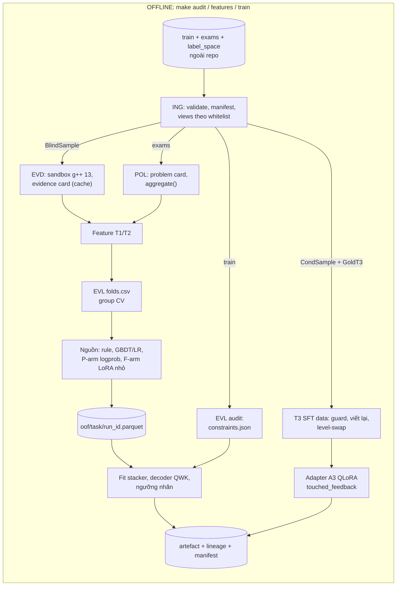
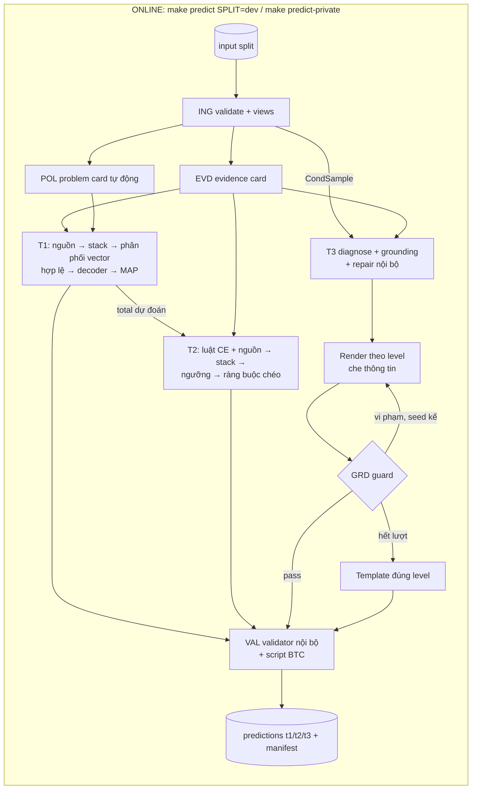

# Đặc tả kỹ thuật: hệ thống chấm rubric, phân loại lỗi và sinh phản hồi bài C++

| Mục | Giá trị |
|---|---|
| Phiên bản | 0.1, bản nháp để nhóm review |
| Ngày | 2026-10-04 |
| Vai trò soạn | Solution Architect |
| Hiện thực cho | [SRS 0.1](02-requirements-srs.md): C-01..C-21, BR-01..BR-25, 88 FR, 22 NFR, Q-01..Q-33 |
| Căn cứ | [EDA](../plans/reports/eda-261003-2335-sample-dataset.md) (ưu tiên khi mâu thuẫn, nhất là §7); [brainstorm](../../plans/reports/brainstorm-261003-2159-llm-grading-challenge.md) (BS); quy ước PY-00..PY-13 |
| ID | **Không định nghĩa ID mới.** Mọi mục trỏ về C/BR/FR/NFR/Q của SRS. Thành phần ghi dạng `package/module.py:symbol` |

**Ký hiệu:**
- **[GT]**: giả thuyết từ mẫu n = 32 (EDA §0). Chỉ áp cứng sau `make audit` trên train chính thức (FR-EVL-10).
- **[KCK]**: cần kiểm chứng kỹ thuật (phiên bản thư viện, hành vi toolchain) bằng `make smoke` (FR-REP-05) hoặc ở gate W1–W2, trước khi pin.
- **chờ Q-xx**: chạy theo cột "Mặc định" của SRS §8 cho tới khi có trả lời.

**Phạm vi:** hệ thống (1), pipeline challenge. Hệ thống (2), trợ lý chấm cho giảng viên, chỉ xuất hiện ở bản (b) "đúng policy" (FR-POL-03) và model card (§3.12, FR-RPT-05, gồm bảng điều kiện duyệt sâu BA §9.3).

---

## 1. Kiến trúc tổng

### 1.1 Nguyên tắc thiết kế

| Nguyên tắc | Cách hiện thực | Căn cứ |
|---|---|---|
| Tín hiệu tất định trước, LLM sau | EVD/POL sinh evidence card; LLM chỉ là một nguồn xác suất trong stack | BS §0; EDA §7.2.2; FR-EVD-01 |
| Policy là feature, không ghi đè | `aggregate()` ra feature; bản (b) áp cứng và bản lai chỉ được nộp nếu thắng (a) trên OOF theo FR-EVL-05 | BR-08; FR-POL-02, FR-POL-03 |
| Giải mã theo metric là tầng riêng | Decoder QWK (T1), ngưỡng theo nhãn (T2), guard (T3); fit trên OOF | FR-T1-07, FR-T2-05, FR-GRD-06 |
| Firewall bằng kiểu dữ liệu + CI | T1/T2 chỉ nhận `BlindSample`; import-linter cấm `t1/t2 → t3`; assert chuỗi con trên prompt | BR-21; FR-ING-05, FR-SEC-01 |
| Cache là nguồn sự thật | Mọi bước không tất định (LLM, sandbox) đi qua cache khoá hash nội dung | FR-REP-03; NFR-REPRO-01 |
| Một backbone, adapter cách ly | Qwen3-8B dùng chung; engine từ chối adapter `touched_feedback` (A3 của T3) cho request T1/T2 | BS §6; FR-SEC-01 (c) |
| Ràng buộc [GT] bật bằng dữ liệu | `make audit` sinh `constraints.json` (không có dẫn xuất feedback/level); T1/T2 chỉ đọc file này, không hard-code EX01/EX02 | FR-EVL-10, FR-T1-02, FR-T2-02 |
| Batch đồng bộ | Một process; vLLM offline `LLM.generate` tự batch; docker CLI gọi tuần tự | PY-00, chờ Q-22 (§1.6) |

### 1.2 Luồng offline (huấn luyện) và online (suy luận)





Thứ tự online cố định: ING → EVD → POL → T1 → T2 (cần total của T1, FR-T2-06) → T3 → VAL. T3 chỉ dùng `CondSample` và evidence; không đọc output T1/T2.

### 1.3 Module ↔ MOD

| MOD | Package | Trách nhiệm | Phụ thuộc | FR |
|---|---|---|---|---|
| ING | `ing/` | Nạp, validate, manifest, join, view theo whitelist, parse `compile_log` | core, shared | FR-ING-01..06 |
| EVD | `evd/` | Sandbox build/run, so khớp output, phân tích tĩnh, near-dup, evidence card | ING, POL (problem card) | FR-EVD-01..08 |
| POL | `pol/` | Problem card tự động, `aggregate()`, trạng thái câu, bản (b) | ING, llm | FR-POL-01..05 |
| T1 | `t1/` | Ràng buộc, nguồn, stack, decoder QWK, MAP vector | EVD, POL, EVL, llm | FR-T1-01..09 |
| T2 | `t2/` | Vocab, luật CE, nguồn, stack theo nhãn, ngưỡng, ràng buộc chéo | EVD, T1, llm | FR-T2-01..08 |
| T3 | `t3/` | Diagnose, grounding, repair, render, template, dữ liệu SFT | EVD, GRD, llm | FR-T3-01..08 |
| GRD | `grd/` | Guard nhiều lớp, retry, fallback, đo dưới mức | EVD (sandbox), llm | FR-GRD-01..07 |
| EVL | `evl/` | Scorer, folds, bootstrap, so sánh, chọn model, judge, audit | ING, GRD | FR-EVL-01..10 |
| VAL | `val/` | Writer, validator, script BTC, submit, quota | ING, constants | FR-VAL-01..06 |
| REP | `rep/`, `llm/cache.py` | Seed, cache, manifest, env, reproduce, smoke | core | FR-REP-01..06 |
| SEC | `sec/` | Firewall, lineage, egress, cô lập test, PII, injection | ING, llm | FR-SEC-01..07 |
| RPT | `rpt/` | Ablation, lát cắt, learning curve, chi phí, bonus, model card, checklist báo cáo | EVL, REP | FR-RPT-01..08 |
| hạ tầng | `core/`, `shared/`, `llm/engine.py` | Settings, exception, log, hàm thuần, engine LLM | — | NFR-MAINT-01, NFR-OBS-01 |

### 1.4 Công nghệ

| Lớp | Lựa chọn | Ghi chú |
|---|---|---|
| Ngôn ngữ, gói | Python 3.11, `uv` + `uv.lock` | `requires-python = "==3.11.*"` (FR-REP-02) |
| Kiểu, cấu hình | pydantic v2, pydantic-settings (TOML + env `GRADER_`) | PY-05 |
| CLI | Typer (sync) bọc bởi `Makefile` | NFR-USAB-01 |
| LLM suy luận | vLLM offline `LLM`: prefix caching, LoRA, guided JSON, logprobs | Pin bản cụ thể sau smoke [KCK] |
| Huấn luyện | transformers + PEFT + TRL (SFT, DPO) + bitsandbytes (QLoRA) | FR-T1-05, FR-T3-04, FR-T3-06 |
| ML cổ điển | LightGBM, scikit-learn (LR, StratifiedGroupKFold, metrics), scipy | FR-T1-09, FR-T2-04 |
| Phân tích C++ | tree-sitter + tree-sitter-cpp | FR-EVD-05, FR-GRD-02 |
| Sandbox | Docker CLI; image dựng từ `gcc:13` pin digest + `python3-minimal`, `util-linux` | FR-SEC-02 |
| Dữ liệu | pandas + pyarrow (parquet OOF), SQLite (cache LLM) | FR-EVL-03, FR-REP-03 |
| Văn bản | rapidfuzz (khớp nhãn), Jinja2 (prompt, template) | FR-T2-01, FR-GRD-06 |
| Chất lượng | ruff, mypy, pytest + coverage, import-linter, pre-commit, gitleaks | NFR-MAINT-01/03, FR-SEC-03 |
| HTTP ra ngoài | httpx sync, chỉ qua `sec/egress.py`, mặc định tắt | FR-SEC-04 |

### 1.5 Cấu trúc repo đề xuất

```
grader/                              # repo private (FR-SEC-03)
├─ pyproject.toml  uv.lock  Makefile  README.md  .importlinter  .pre-commit-config.yaml  .gitleaks.toml
├─ configs/   default.toml  fast.toml  final.toml  ablation.yaml  label_defs.yaml
├─ docker/    app.Dockerfile  sandbox.Dockerfile  runner.py  seccomp.json  ex01_harness.cpp
├─ schemas/   evidence_card.v1.json  problem_card.v1.json  predictions.{t1,t2,t3}.json   # xuất từ pydantic
├─ src/grader/
│  ├─ cli.py          # Typer; nơi DUY NHẤT gắn @handle_errors (PY-03)
│  ├─ constants.py    # DIMS, miền, 10 nhãn, 4 level, TIMEOUT_MARKER; đối chiếu LS lúc khởi động
│  ├─ core/    config.py  exceptions.py  errors.py  logging.py  run_context.py
│  ├─ shared/  unicode.py  hashing.py  jsonio.py  cpp_lexer.py  textcompare.py  vietnamese.py
│  ├─ llm/     engine.py  cache.py  forced_choice.py  banned_tokens.py  prompts/*.j2
│  ├─ ing/     schemas.py  loader.py  manifest.py  compile_log.py  views.py  gold.py
│  ├─ evd/     toolchain.py  sandbox.py  build.py  tests_run.py  static.py  neardup.py  card.py
│  ├─ pol/     problem_card.py  extract.py  aggregate.py  status.py
│  ├─ t1/      features.py  constraints.py  sources.py  p_arm.py  f_arm.py  stack.py  decoder.py  pipeline.py
│  ├─ t2/      vocab.py  rules.py  p_arm.py  f_arm.py  stack.py  thresholds.py  augment.py  pipeline.py
│  ├─ t3/      diagnose.py  grounding.py  repair.py  render.py  style.py  sft_data.py  pipeline.py  templates/vi/
│  ├─ grd/     rules.py  lexical.py  syntax.py  contextual.py  verbal.py  exec_leak.py  underlevel.py  guard.py
│  ├─ evl/     metrics.py  folds.py  bootstrap.py  compare.py  select.py  judge.py  audit.py
│  ├─ val/     formats.py  writer.py  validator.py  submit.py
│  ├─ rep/     seeds.py  manifest.py  envinfo.py  reproduce.py  smoke.py
│  ├─ sec/     firewall.py  lineage.py  egress.py  isolation.py  pii.py
│  └─ rpt/     ablation.py  slices.py  learning_curve.py  costs.py  model_card.py  report_check.py  doc_lint.py  bonus/
├─ tests/  unit/  integration/  fixtures/synthetic/      # fixture tự viết, không chứa code SV thật
└─ (ngoài repo, trỏ qua Settings) DATA_ROOT  CACHE_DIR  RUNS_DIR  ADAPTERS_DIR
```

### 1.6 Áp quy ước Python (bổ sung SRS §5.1)

| Mã | Áp dụng |
|---|---|
| PY-00 | **Đề xuất sync**: workload là batch offline khoảng 120 bài [GT]; vLLM offline và docker CLI đều đồng bộ, vLLM tự batch; không có I/O mạng đồng thời (chạy offline, NFR-PRIV-02). Nhóm chốt ở **Q-22** và ghi README trước khi init repo (NFR-MAINT-02). Nếu chọn async: `AsyncLLMEngine`, `httpx.AsyncClient`, `asyncio.to_thread` cho sandbox và tree-sitter; không trộn hai kiểu |
| PY-03, PY-04 | `core/errors.py:handle_errors` chỉ gắn ở command trong `cli.py`. Lỗi từng bài có fallback định trước (§6.2) được xử lý tại stage, log một lần. Cây exception ở §6.2 |
| PY-05, PY-06 | `Settings.load(config_path)` gọi một lần trong `cli.py`, truyền xuống qua `RunContext`; module nghiệp vụ không gọi `os.environ`. Literal cấu hình nằm trong `configs/*.toml`; literal còn sót phải có `# TODO(hardcode): <lý do> — <ai xác nhận>` |
| PY-09, PY-10, PY-13 | `shared/` chỉ hàm thuần. Engine, tokenizer, parser tree-sitter dựng lười trong factory; không load model, không đọc file lúc import. Type hint cho hàm public; mypy `strict` cho `core/`, `shared/`, `val/`, `evl/`, `sec/` |
| PY-12 | Test dùng `tests/fixtures/synthetic/`. Bộ 32 bài chỉ trỏ qua `Settings.test.sample_root`, test bị skip nếu thiếu; không đường fallback nào về dữ liệu mẫu khi chạy thật |

---

## 2. Hợp đồng dữ liệu

### 2.1 Input đúng như bộ mẫu (`ing/schemas.py`)

Envelope để `extra="allow"`: trường mới ở tập đầy đủ (ví dụ `compiles_locally`, Q-17) chỉ bị audit cảnh báo, không làm dừng. Gold T1 **không** ép total = Σ lúc nạp (BR-01 là [GT]); audit đo tỷ lệ.

```python
ExamType = Literal["multi_problem", "single_problem"]
Level = Literal["Level 1 - Gợi ý nhẹ", "Level 2 - Chẩn đoán", "Level 3 - Gợi ý sửa", "Level 4 - Lời giải mẫu"]
I01 = Annotated[int, Field(strict=True, ge=0, le=1)]

class ReportedCase(BaseModel):              # actual đã strip (BR-11); "<TIMEOUT>" = timeout; "" = nghi crash
    input: str; expected: str; actual: str; passed: bool

class T12Input(BaseModel):                     # T1 ≡ T2 (FR-ING-04)
    exam_id: str; exam_type: ExamType; language: str; code_file: str
    compile_log: str                                # bắt buộc, cho phép "" (SRS §6.1)
    test_report: list[ReportedCase] | None = None   # None: multi; []: single không build được

class T3Input(BaseModel):                      # không có test_report (BR-23)
    exam_id: str; exam_type: ExamType; language: str; code_file: str; compile_log: str   # bắt buộc, cho phép ""
    taxonomy_error: list[str]; target_feedback_level: Level

class Rubric(BaseModel):
    model_config = ConfigDict(extra="forbid")
    compilable: I01; io_format: I01; complexity: I01; code_quality: I01
    logic: Annotated[int, Field(strict=True, ge=0, le=4)]
    edge_case: Annotated[int, Field(strict=True, ge=0, le=2)]

class T1Output(BaseModel): rubric: Rubric; total_score: Annotated[int, Field(strict=True, ge=0, le=10)]
class T2Output(BaseModel): taxonomy_error: list[str]
class T3Output(BaseModel): feedback: str

class Sample(BaseModel, Generic[In, Out]):
    sample_id: str; input: In; output: Out | None = None     # dev/test: không có output

class TaskFile(BaseModel, Generic[In, Out]):
    model_config = ConfigDict(extra="allow")
    task: str; description: str; input_fields: list[str]; output_fields: list[str]; metric: str
    n_samples: int; samples: list[Sample[In, Out]]
    label_space: list[str] | None = None                      # chỉ T2
    level_definition_ref: str | None = None                   # chỉ T3
    # model_validator: n_samples == len(samples); sample_id duy nhất (FR-ING-01)

class MultiProblem(BaseModel): pid: str; max_score: float; prototype: str; is_prerequisite_for: list[str] = []
class SingleProblem(BaseModel): pid: str; max_score: float; io_mode: str; constraints: str | None = None

class Exam(BaseModel):
    model_config = ConfigDict(extra="allow")
    exam_id: str; exam_type: ExamType; language: str; course: str; week: int
    topic: list[str]; learning_outcome: str; bloom_level: list[str]; programming_skill: list[str]
    problem_type: str; difficulty_teacher: str; estimated_time_min: int
    statement: str; problems: list[MultiProblem | SingleProblem]
    grading_policy: str | None = None; has_hidden_testcases: bool; note: str | None = None

class LevelDef(BaseModel):
    level: Level; definition: str = Field(alias="định nghĩa"); forbidden: str = Field(alias="cấm")
class LabelSpace(BaseModel):
    rubric: RubricSpace; taxonomy_error: list[str]; feedback_level: list[LevelDef]   # khớp constants.py
```

### 2.2 Sample nội bộ và firewall theo kiểu (`ing/views.py`, `ing/gold.py`)

```python
class CodeText(BaseModel):
    text: str; raw_sha1: str; encoding: str; had_bom: bool; n_lines: int   # text: NFC, đã bỏ BOM (FR-ING-02)

class BlindSample(BaseModel):            # T1/T2: KHÔNG có feedback, level, taxonomy_error (FR-ING-05, BR-21)
    model_config = ConfigDict(frozen=True, extra="forbid")
    sample_id: str; exam_id: str; exam_type: ExamType; code: CodeText
    compile_log: str; test_report: tuple[ReportedCase, ...] | None
    # classmethod from_record(rec: SampleRecord): copy đúng các trường whitelist, không dùng **rec

class CondSample(BaseModel):             # T3 (BR-22, BR-23)
    model_config = ConfigDict(frozen=True, extra="forbid")
    sample_id: str; exam_id: str; exam_type: ExamType; code: CodeText; compile_log: str
    taxonomy_error: tuple[str, ...]; level: Level
    t1_test_report: tuple[ReportedCase, ...] | None = None   # chỉ khi t3.use_t1_test_report (chờ Q-14)

class GoldStore:                         # chỉ train/dev có nhãn
    def view(self, task: Literal["t1"]) -> GoldT1View: ...      # overload theo task;
    # GoldT1View/GoldT2View không có phương thức nào trả feedback; chỉ GoldT3View có .feedback(sid)
```

Mã SV (phần `S1xx` trong sample_id) chỉ dùng làm khoá và group, không thành feature (BR-25, FR-SEC-06).

### 2.3 EvidenceCard (`evd/card.py`, JSON Schema `schemas/evidence_card.v1.json`)

```python
FailClass = Literal["wrong", "empty_crash", "prompt_only", "prompt_wrong", "timeout"]

class CompileLogInfo(BaseModel):         # FR-ING-06, từ log gốc; tên cờ theo SRS FR-ING-06
    log_has_error: bool; log_has_link_error: bool; log_build_failed: bool; log_warning_only: bool
    log_truncated: bool; n_errors: int; n_errors_is_lower_bound: bool   # = log_truncated
    n_warnings: int; error_lines: list[str]         # ≤ 5 dòng diagnostic đầy đủ (bỏ dòng dở cuối log bị cắt)

class RebuildResult(BaseModel):          # FR-EVD-04
    toolchain_id: str; profile: str; returncode: int; has_error: bool; link_error: bool; build_failed: bool
    warnings: list[str]; truncated_log: str        # cắt cùng quy ước log gốc (data.compile_log_trunc_len)
    agrees_with_given: bool                         # build_failed của rebuild == log_build_failed của log gốc

Verdict = Literal["ok", "nonzero_exit", "signal", "timeout", "memory_limit"]

class TestRun(BaseModel):
    idx: int; source: Literal["given_report", "rerun"]
    raw_stdout: str | None                          # None khi chỉ có report đã strip
    returncode: int | None; signal: int | None; timeout: bool; duration_ms: int | None
    verdict: Verdict | None; output_truncated: bool # cắt ở sandbox.stdout_cap_bytes
    agrees_with_report: bool | None                 # rerun: stdout.strip() == actual của report
    strict_pass: bool; lenient_pass: bool
    prompt_prefix: bool; leading_ws: bool; trailing_ws: bool; case_mismatch: bool
    fail_class: FailClass | None

class RunEvidence(BaseModel):            # FR-EVD-02, FR-EVD-03
    n_tests: int; strict_rate: float; lenient_rate: float; io_gap: float
    n_by_fail_class: dict[FailClass, int]; crash_suspected_ub: bool
    rerun_agreement: float | None; nondeterministic: bool; constant_output: bool   # mọi test cùng một stdout
    tests: list[TestRun]

class FunctionInfo(BaseModel):           # theo prototype trong ProblemCard
    present: bool; prototype_match: bool; empty_or_stub: bool; n_statements: int; suspect_infinite_loop: bool

class StaticEvidence(BaseModel):         # FR-EVD-05, FR-EVD-06
    n_lines: int; effective_code_lines: int; commented_out_ratio: float; max_commented_block: int
    all_commented: bool; has_main: bool; functions_present: dict[str, FunctionInfo]   # {} với single
    disallowed_includes: list[str]; forbidden_calls: list[str]
    hardcode_fixed_path: bool; hardcode_cin_instead_of_file: bool; hardcode_fixed_array_size: bool

class EvidenceCard(BaseModel):           # khoá (code_sha, toolchain_id); KHÔNG có trường feedback
    model_config = ConfigDict(extra="forbid")
    schema_version: Literal["1.0"]; sample_id: str; exam_id: str; exam_type: ExamType
    code_sha: str; toolchain_id: str; evidence_mode: Literal["full", "given_signals_only"]
    missing_code: bool                              # FR-ING-03, chế độ predict
    compile_given: CompileLogInfo; compile_rebuild: RebuildResult | None
    run: RunEvidence | None                         # None với multi (FR-EVD-08 = W)
    static: StaticEvidence; cluster_id: str; cluster_size: int          # FR-EVD-07
    problem_status: ProblemStatus | None            # {split_failed: bool; by_pid: pid → P{correct, partial, wrong, missing}} (FR-POL-04)
    policy: PolicyFeatures | None
    text: str                                       # bản gọn ≤ evd.card_text_max_tokens, không chứa code
```

### 2.4 ProblemCard và PolicyFeatures (`pol/problem_card.py`)

```python
class ZeroClause(BaseModel):
    kind: Literal["compile_fail", "infinite_loop", "plagiarism", "rule_violation", "other"]
    scope_written: Literal["file", "question"]; source_text: str

class ProblemSpec(BaseModel):
    pid: str; prototype: str | None; io_mode: str | None
    weight_statement: float | None; weight_max_score: float; prerequisite_of: list[str]

class ProblemCard(BaseModel):
    schema_version: Literal["1.0"]; exam_id: str; exam_sha: str; exam_type: ExamType
    problems: list[ProblemSpec]; weights_used: dict[str, float]; weight_conflict: bool
    prereq_edges: list[tuple[str, str]]             # (tiên quyết, phụ thuộc); đã kiểm DAG
    zero_clauses: list[ZeroClause]; allowed_includes: list[str] | None; forbidden_calls: list[str]
    compile_profile: Literal["syntax_only", "build"]
    public_tests: list[tuple[str, str]]             # (input, expected) từ statement/EXM; gom từ test_report chỉ khi Q-14 cho phép
    answer_vocab: list[str]                         # vd ["True", "False"] với EX02
    policy_failed: bool; extraction_method: Literal["regex", "regex+llm", "fallback_uniform"]
    llm_revision: str | None; votes: int

class PolicyFeatures(BaseModel):         # đầu ra aggregate(): FEATURE, không ghi đè (BR-08)
    hard_score: float; soft_score: float            # thang 0..10
    prereq_failed: bool; n_missing: int; zero_clause_hits: list[str]
```

### 2.5 Output và `predictions.json` (đề xuất, chờ Q-01)

- `T1Prediction(T1Output)` thêm `model_validator` ép total = Σ (BR-01) và metadata nội bộ `gate_source ∈ {exam, exam_type_default, none}` (ghi vào OOF/log, không ghi ra file nộp). `T2Prediction` ép ⊆ LS, NFC, không trùng, thứ tự LS. `T3Prediction` ép chuỗi không rỗng.
- Mặc định (SRS §6.3): mỗi task một file, top-level là mảng `[{"sample_id": …, "output": <đúng trường output của file task>}]`. `val/formats.py:SubmissionFormat(layout, output_style, files)` đổi được sang object bọc ngoài, output phẳng, hoặc một file chung khi Q-01 có trả lời.

| Quy tắc validator (`val/validator.py`) | Kiểm | FR |
|---|---|---|
| Mã hoá | UTF-8, không BOM, JSON hợp lệ | FR-VAL-01 |
| Cấu trúc | Đúng `layout`; mỗi phần tử đúng 2 khoá `sample_id`, `output` | FR-VAL-01 |
| Phạm vi id | Tập id = tập id input của split; không trùng; thứ tự như input | FR-VAL-01 |
| Kiểu số | `int` thật (từ chối `bool`, float, `7.0`); trong miền BR-02 | FR-VAL-04, BR-02 |
| Tổng | `total_score` = Σ 6 chiều | BR-01 |
| Nhãn | Chuỗi NFC ∈ LS, không trùng, thứ tự LS; `[]` hợp lệ | BR-12, BR-13 |
| Feedback | Không rỗng sau strip; không ký tự điều khiển trừ `\n`; nhận diện tiếng Việt | FR-T3-01 |
| Kết luận | Báo **mọi** lỗi kèm sample_id và trường; chặn nộp nếu khác kết luận script BTC | FR-VAL-02 |

---

## 3. Đặc tả từng module

Mỗi module ghi: I/O, các bước, cấu hình (khoá trong `Settings`, bảng §5.1), lỗi và fallback. FR đầy đủ ở §7.

### 3.1 ING: nạp dữ liệu

- **I/O:** `data_root`, `split` → `Dataset{exams, label_space, records, gold: GoldStore | None}`.
- **Bước:**
  1. `manifest.py:verify_manifest(root)`: sha256 mọi file, bỏ `.DS_Store`, `._*`, `__MACOSX/` (bộ mẫu có 2 `.DS_Store`). Lệch → `DataIntegrityError(file, expected, observed)`. Cảnh báo `.cpp` không được tham chiếu. `code_file` thiếu: train/audit → `DataIntegrityError` (exit 2); predict/predict-private → không dừng, bài đó chạy `given_signals_only` với code rỗng, card `missing_code = true`, ghi vào `private_audit.jsonl`, ra fallback hợp lệ (FR-ING-03).
  2. `loader.py:load_label_space`: đối chiếu `constants.py` (10 nhãn NFC, 4 level, miền) và sha của khối `feedback_level`. Lệch → `ConfigError`, buộc review luật GRD.
  3. `load_task_file(path, In, Out)`: gom **mọi** lỗi pydantic rồi raise `DataSchemaError(file, sample_id, field, observed)` (FR-ING-01, NFR-USAB-02). Trong `PrivateRun`, `observed` chỉ ghi kiểu, độ dài và sha1, không ghi giá trị; message exception đi qua `LogSafeFilter` (FR-SEC-05).
  4. `read_code`: bytes → `raw_sha1` → decode utf-8 → cp1258 → latin-1 (đếm số file fallback) → bỏ BOM (EX01-S107) → NFC (FR-ING-02).
  5. `join_tasks`: id duy nhất; input T1 ≡ T2; T3 = T1 − `test_report` + `taxonomy_error` + `target_feedback_level`; bảng giao sample_id T2/T3 cho train/dev. Split test: chỉ tính **bên trong `PrivateRun`**, chỉ ghi số đếm (`overlap=n`, không id, không nội dung) vào `runs/private_audit.jsonl`; giao > 0 → kết thúc kèm cảnh báo, báo giảng viên (FR-ING-04, BR-22).
  6. `compile_log.py:parse_compile_log`: giữ nguyên regex đã kiểm của `load_data.py` (`COMPILE_ERROR_RE` = dòng `file:line:col: (fatal )?error:`; `LINK_ERROR_RE` = `undefined reference`, `collect2: error`, `ld returned`); `truncated` ⇔ `len(log) == data.compile_log_trunc_len` (FR-ING-06; EDA §5: 22 log rỗng, 6 diag error + 1 link, 3 chỉ warning, 1 bị cắt).
  7. `views.py`: `BlindSample.from_record`, `CondSample.from_record`; `gold.py:GoldStore.view(task)`. Cô lập: `split="private"` chỉ đọc được khi `sec/isolation.py:PrivateRun` đang mở (FR-SEC-05).

### 3.2 EVD: evidence và sandbox

**Profile toolchain** (`evd/toolchain.py`; `toolchain_id = sha1(image_digest | flags | sha runner.py)[:12]`):

| Profile | multi_problem | single_problem | Ghi chú |
|---|---|---|---|
| `gcc13-O0` (mặc định) | `g++ -std=c++11 -fsyntax-only student.cpp` (khớp `note` của EX01) | `g++ -std=c++11 -O0 -o prog student.cpp` | GCC 13 bật `-funreachable-traps` mặc định ở -O0, nên hàm non-void thiếu return sẽ trap [KCK] |
| `gcc13-O0-ubsan` | như trên | + `-fsanitize=return -fno-sanitize-recover=all` | Dùng nếu bản mặc định không tái lập `actual=''` |
| `clang-O0-trap`, `gcc12-O2` | — | đối chứng | Chỉ để calibrate; EDA §5 đo được 104/104 và 96/104 |

- **Calibrate** (`grader evd calibrate`): chạy mọi profile trên EX02 của train; **chỉ chọn trong các profile `gcc13-*`** (pin FR-EVD-04) bản tái lập nhiều `actual` nhất (`stdout.strip()` so với `actual`, `<TIMEOUT>` ↔ timeout). `clang-*`, `gcc12-*` chỉ để báo cáo. Chấp nhận ≥ 96/104 trên mẫu; gcc13 < 96/104 thì ghi vào Q-17 và hồ sơ bonus, không đổi toolchain ngầm. Profile chọn ghi vào `constraints.json` và manifest.
- **Harness EX01** (tắt, FR-EVD-08 = W, chờ Q-16): `g++ -std=c++11 -c -Dmain=student_main` + `docker/ex01_harness.cpp` khai báo stub `__attribute__((weak))` cho mọi prototype của ProblemCard, để link được cả khi thiếu hàm. Chỉ bật khi có `generals.csv`.
- **Lệnh sandbox** (`evd/sandbox.py:run_in_sandbox`, mỗi bài một container, FR-SEC-02, NFR-SEC-01):

```bash
docker run --rm --name grader-<run_id>-<code_sha8> --network none --read-only \
  --tmpfs /work:rw,exec,nosuid,size=64m --tmpfs /tmp:rw,nosuid,size=16m -e TMPDIR=/work \
  --memory 512m --memory-swap 512m --cpus 1 --pids-limit 64 --ulimit nofile=64:64 --ulimit fsize=8388608 \
  --user 65534:65534 --cap-drop ALL --security-opt no-new-privileges --security-opt seccomp=docker/seccomp.json \
  -v <tmpdir_bai>:/in:ro <sandbox_image@sha256:…> python3 /in/runner.py --profile gcc13-O0
```

- `--tmpfs` mặc định là `noexec`, nên `/work` phải ghi rõ `exec` [KCK]. Host đặt `subprocess.run(timeout=sandbox.sample_timeout_s)`; quá hạn thì `docker kill` và verdict `sample_timeout`.
- `runner.py` (stdlib): compile (timeout `compile_timeout_s`) → mỗi test chạy `timeout -s KILL <t> setarch $(uname -m) -R ./prog < k.in`, cắt stdout ở `stdout_cap_bytes`, ghi returncode, signal (= rc − 128), thời gian → in **một JSON** ra stdout container để host đọc (tmpfs mất khi container kết thúc).
- `setarch -R` cần syscall `personality(ADDR_NO_RANDOMIZE)`, có thể bị seccomp mặc định chặn → `seccomp.json` = profile mặc định + cho phép giá trị này [KCK]. Nếu không được: `disable_aslr=false`, chạy mỗi test 2 lần, khác nhau thì `nondeterministic=true` (NFR-REPRO-04).
- **So khớp** (`shared/textcompare.py`, FR-EVD-02):
  - strict: `stdout.strip() == expected.strip()` (cùng quy ước strip của report gốc).
  - lenient: bỏ tiền tố trước token `answer_vocab` cuối, gộp khoảng trắng, casefold.
  - `prompt_prefix`: có văn bản trước token trả lời. `leading_ws`/`trailing_ws`: stdout thô có khoảng trắng thừa (chỉ phát hiện được khi rerun, EX02-S205). `case_mismatch`: bằng nhau sau casefold.
  - `io_gap` = lenient_rate − strict_rate.
- **Phân loại fail** (FR-EVD-03), xét theo thứ tự: `timeout` (`actual == "<TIMEOUT>"` hoặc bị kill) → `empty_crash` (`actual == ""` hoặc có signal; gắn `crash_suspected_ub`, không coi là "không in gì") → `prompt_only` (lenient pass) → `prompt_wrong` → `wrong`. Kỳ vọng trên 57 test fail của mẫu: wrong 17, empty_crash 16, prompt_only 11, timeout 8, prompt_wrong 5 (EDA §2.3).
- **Phân tích tĩnh** (`evd/static.py`, tree-sitter, chạy được cả khi CE; FR-EVD-05, FR-EVD-06):
  - Hàm theo prototype: khớp tên + kiểu tham số đã chuẩn hoá. Hàm rỗng/stub: 0 statement hoặc chỉ `return` hằng.
  - Vòng lặp nghi vô hạn: `for(;;)`/`while(true)` không có break/return; điều kiện `while` không có biến nào bị gán trong thân (bắt kiểu duyệt list thiếu `cur = cur->next`).
  - Hard-code: mở file bằng literal trong khi tham số `filename` không dùng; `cin >>` trong hàm đọc file; cấp phát mảng với kích thước literal.
  - `#include` ngoài `allowed_includes`; lời gọi trong `forbidden_calls` (EX02: `pow`).
  - `effective_code_lines` (dòng không trống, không thuộc node comment); `commented_out_ratio` (dòng comment trông như code: có `;`, `{`, `}`); `max_commented_block`; `all_commented` ⇔ `effective_code_lines == 0`.
  - Kỳ vọng mẫu: 6/15 bài đủ 4 hàm, 10/15 còn main, EX02-S214 bật `all_commented`, EX02-S209 có khối comment ≥ 20 dòng (EDA §2.4, §5).
- **Near-dup** (`evd/neardup.py`, FR-EVD-07): token hoá bằng `shared/cpp_lexer.py`, bỏ token của code mẫu trong `statement`, identifier → `ID`, literal → `LIT`; shingle k = 5; Jaccard **chính xác** từng cặp trong exam (N nhỏ, không cần MinHash); union-find với ngưỡng `evd.neardup_jaccard`; `cluster_id = "c" + sha1(",".join(sorted(sample_ids)))[:10]`. Ngưỡng calibrate trên train (`grader evd calibrate-neardup`): trên mẫu phải cho S203..S206 cùng cụm và 13 bài EX02 còn lại là singleton (EDA §5: S203–S206 có Jaccard 0.59–0.95, không cặp nào khác ≥ 0.7); giá trị chọn và phân bố Jaccard ghi vào `audit.md`; cụm > `evd.neardup_max_cluster_frac` số bài của exam → cảnh báo audit.
- **Cache:** lõi card ở `cache/evidence/<toolchain_id>/<code_sha>-<tests_sha>.json`. Chạy 2 lần phải ra card giống từng byte.
- **Lỗi:** CE, crash, timeout của code SV là **dữ liệu**, không raise. Docker hoặc daemon lỗi → `SandboxError`. Với `sandbox.on_error = "given_signals"`, card chuyển `evidence_mode = "given_signals_only"` và log.exception một lần; mặc định `fail` khi train, `given_signals` khi predict.

### 3.3 POL: chính sách multi_problem

- **`extract.py:ProblemCard.from_exam(exam, split_inputs, llm)`** (FR-POL-01). Cache theo sha mục exam + phiên bản extractor + revision LLM.
  1. Regex: trọng số trong statement (`Problem (\d+) \((\d+(?:[.,]\d+)?) điểm\)`); thư viện cho phép; hàm cấm (cụm "không được dùng" + tên trong backtick, bỏ qua ký hiệu markdown như `*`); điều khoản 0 điểm ("Nhận 0 điểm nếu: …"); `compile_profile` từ `note` (`-fsyntax-only` → `syntax_only`); `public_tests` (dùng cho repair T3, exec-leak GRD) lấy từ statement/EXM, chỉ gom từ `test_report` khi Q-14 cho phép (`t3.use_t1_test_report`); không có thì tắt repair và exec-leak. `answer_vocab` từ statement hoặc `expected` của `test_report` (chỉ phục vụ EVD của T1/T2, vốn dùng test của chính input T1/T2).
  2. Trường regex không lấy được: LLM guided JSON, self-consistency `pol.self_consistency_k = 5`, seed `seed_for("pol", exam_id, i)`, bỏ phiếu theo trường.
  3. Validate: đồ thị tiên quyết là DAG (topological sort); trọng số > 0; Σ `weights_used` = 10; pid tồn tại. Thất bại → `PolicyExtractionError`, bắt ngay tại `extract.py` → trọng số đều + `policy_failed = true`, pipeline chạy tiếp.
  4. `weights_used` = trọng số statement nếu có (EDA §2.4: comment khung đề trong S102 ủng hộ 1/4/2/3), ngược lại `max_score`. `weight_conflict` khi hai vector chuẩn hoá lệch nhau. Cả hai cùng sinh feature để ablation (chờ Q-08).
  5. Chỉ audit tay trên exam của train (đo độ chính xác bộ trích). Cấm viết tay card cho exam chỉ có ở dev/test (C-05).
- **`aggregate.py:aggregate(status, card, variant)`** (FR-POL-02), tất định, ≥ 10 unit test:
  - s_q: `hard` lấy argmax status → {correct: 1, partial: `pol.partial_credit`, wrong: 0, missing: 0}; `soft` lấy kỳ vọng.
  - `hard`: q nhận 0 nếu có p tiên quyết của q với status ∈ {wrong, missing}.
  - `soft`: score = 10 · Σ_q w_q · E[s_q] · Π_{p→q} P(pass_p) / Σ_q w_q, với P(pass_p) = P(correct) + partial · P(partial).
  - Lặp vô hạn: `pol.infinite_loop_scope = "question"` (như gold, BR-09) hoặc `"file"` (như đề viết).
- **`status.py:estimate_problem_status`** (FR-POL-04): hàm thiếu hoặc stub → `missing` (P = 1). Các hàm còn lại: P-arm forced-choice 4 lựa chọn trên đoạn code của hàm + mục đề tương ứng + cờ tĩnh. Chỉ nhận `BlindSample`.
- **Bản (b) đúng policy** (FR-POL-03): hậu xử lý trên output T1 bản (a). `prereq_failed` (hard, từ `status.py`) ⇒ logic = edge_case = complexity = code_quality = 0, tức vector (compilable, io_format, 0, 0, 0, 0), total ≤ 2; zero-clause scope `file` ⇒ `000000`. **Lai:** chỉ áp cổng khi P(P1 sai) ≥ τ, τ fit trên OOF. Điểm vận hành nộp do `evl/select.py` chọn trên OOF train chính thức giữa (a), (b), lai, ghi `runs/decisions.jsonl`; (b) luôn dùng cho model card và hồ sơ bonus.
- **Gating mềm** (FR-POL-05, C): `rpt/bonus/soft_gating.py` fit (τ, T) của cổng sigmoid bằng scipy trên dữ liệu mức file; CI bootstrap.

### 3.4 T1: chấm rubric

1. **Ràng buộc** (`constraints.py:ConstraintSet.mine(train, audit)`, FR-T1-02): theo exam (theo exam_type cho exam mới), với mỗi chiều d ≠ logic, kiểm d có là hàm tất định của (logic, CE) với độ khớp ≥ `t1.constraint_min_agreement` không. Có → bảng tra. Không → d có mô hình riêng (LR nhị phân/ordinal). EX01 thêm `edge_case` làm biến dự đoán. Kỳ vọng mẫu: EX02 edge = logic/2, code_quality = 1; EX01 complexity = code_quality = [logic > 0] (BR-05, BR-06 [GT]). Kết quả là tập vector hợp lệ V_e.
2. **Cổng CE** (`apply_ce_gate`, FR-T1-03): `compile_given.log_has_error` (log thiếu thì dùng rebuild) ⇒ vector cổng = mode vector của bài CE cùng exam trên train (đòi khớp ≥ 0.99, `gate_source = exam`); exam mới lấy theo exam_type (`gate_source = exam_type_default`, Q-26). Lỗi link **không** kích hoạt cổng (BR-15).
3. **Nguồn** (OOF, mỗi nguồn ra P(logic), EX01 thêm P(edge)):

| Nguồn | Hiện thực | FR |
|---|---|---|
| R: luật | single: `rubric_prior` = 2 + 8 · lenient_rate, ánh xạ về level gần nhất; multi: theo số hàm có mặt và không stub | FR-T1-06 |
| G: GBDT/LR | LightGBM (`num_leaves=4`, `min_data_in_leaf=5`, `n_estimators ≤ 300`, `learning_rate=0.05`, monotone: + lenient_rate, − n_empty_crash, + số hàm có mặt) hoặc LR multinomial; chọn bằng nested CV | FR-T1-08 |
| P: P-arm | Prompt (đề, code đánh số dòng, card text) + tiền tố trả lời `{"logic": `; đọc logprob **raw** của token kế tiếp cho từng giá trị hợp lệ, chuẩn hoá lại. Không dùng guided decoding khi đọc logprob; tắt thinking của Qwen3 | FR-T1-04 |
| F: F-arm | Theo cổng D0 (§5.3): LoRA trên Qwen3-1.7B/4B + head ordinal (K−1 logit tích luỹ, loss CORN), suy luận bằng transformers qua `llm/cache.py` (§3.10). Đối chứng P-small: cùng prompt P-arm chạy trên đúng base của F-arm | FR-T1-05, FR-EVL-08 |

4. **Stack** (`stack.py`, FR-T1-09): theo exam_type, LR multinomial (C chọn bằng inner CV) trên [log P_R, log P_G, log P_P, log P_F, cờ CE], fit trên OOF group CV. Chỉ giữ khi QWK OOF hơn thành phần tốt nhất ngoài CI (paired bootstrap); không thì dùng thành phần tốt nhất và ghi quyết định.
5. **Phân phối vector:** P(v) ∝ Π_d P_d(v_d) · 1[v ∈ V_e]; P(t) = Σ_{total(v)=t} P(v); điểm liên tục s = Σ_t t · P(t).
6. **Decoder** (`decoder.py`, FR-T1-07): (a) rescale z = μ_gold + σ_gold · (s − μ_s)/σ_s, làm tròn `floor(z + 0.5)` (không banker's rounding), snap về lưới T_e = {total(v) : v ∈ V_e}; (b) OptimizedRounder: ngưỡng t_1 < … < t_{K−1} trên s tối đa QWK OOF (coordinate descent, khởi tạo trung điểm, `seed_for("decoder")`). Fit theo exam khi n_exam ≥ `t1.decoder_min_n_per_exam`, ngược lại pooled trên s đã chuẩn hoá theo exam. Chọn (a), (b) hay không decoder bằng nested CV. Kiểm std(pred)/std(gold) ∈ [0.8; 1.2].
7. **MAP:** v* = argmax_{v ∈ V_e, total(v) = t*} P(v) → `T1Prediction` (total = Σ, FR-T1-01).
8. **Baseline** (FR-T1-06): `median_by_exam`, `ce_rule` (`log_has_error` → 0, còn lại 10), `rubric_prior`. Unit test tái tạo EDA §2.5: QWK pooled 0.512 (EX01 0.413, EX02 0.636), MAE 2.91; median theo exam 0.219.
9. **OOF** `oof/t1/<run_id>.parquet`: sample_id, fold, exam_id, cluster_id, source, `p_level_*`, s, t_pred.
- **Lỗi:** logprob thiếu ứng viên hoặc parse fail → retry 1 lần với prompt rút gọn → vẫn lỗi thì cột P = prior của exam + cờ `p_arm_missing` (tỷ lệ phải ≤ 1%, FR-T1-04).

### 3.5 T2: phân loại lỗi đa nhãn

1. **Vocab** (`vocab.py:LabelVocab.match`, FR-T2-01): NFC → casefold → khớp chính xác → rapidfuzz `ratio ≥ t2.vocab_fuzzy_min` → còn lại bỏ + log WARNING (sample_id, sha chuỗi). Bỏ trùng, sắp theo thứ tự LS.
2. **Luật CE** (`rules.py`, FR-T2-02): override cứng chỉ khi audit thấy bộ ba (compilable, `log_has_error`, nhãn) khớp ≥ 0.99; ngược lại là feature mạnh. Lỗi link chỉ là feature (BR-15).
3. **Nguồn** (OOF, 10 cột):
   - **P-arm** (`p_arm.py`, FR-T2-03): 10 prompt yes/no chung tiền tố (đề theo exam, code, card text) + định nghĩa vận hành trong `configs/label_defs.yaml` (viết từ LS, code và nhãn train, không chép feedback; ghi lineage tác giả theo Q-05; chờ Q-18) + phản ví dụ + câu "có thể không có lỗi nào". Đọc logprob raw của token `yes`/`no` (smoke kiểm là token đơn) → softmax.
   - **G** (`f_arm.py`, FR-T2-04): LR L2 `class_weight="balanced"` và LightGBM nhỏ trên evidence + TF-IDF char 3–5-gram của code, one-vs-rest. Là nguồn học được, không tính F-arm (C-02).
   - **F** (theo D0): LoRA đa nhãn trên model nhỏ, sigmoid 10 nhãn; đối chứng P-small trên cùng base (FR-EVL-08).
   - **T1 mềm:** total dự đoán và P(logic) OOF chỉ là feature (BR-16), có ablation bỏ.
4. **Stack theo nhãn** (`stack.py`): LR trên logit các nguồn + cờ CE, Platt trong CV. Nhãn có < `t2.min_pos_stack` positive: trung bình logit, không fit.
5. **Ngưỡng** (`thresholds.py`, FR-T2-05): bootstrap theo cụm B = `t2.threshold_bootstrap_B` trên OOF → argmax F1 mỗi replicate → median τ_l → co về ngưỡng chung: τ_l ← (n_l · τ_l + m · τ_0)/(n_l + m), m = `t2.threshold_shrink_m`. Nhãn có F1 OOF không thắng mốc 2π/(1+π) → dùng hằng số tốt hơn trong {luôn đoán, không đoán}, đánh giá dưới cả 3 quy ước zd. Sanity: τ ≈ F\*/2 khi xác suất đã calibrate (BS §4.2).
6. **Nhãn 0-support** (FR-T2-07): "Lỗi edge case" chỉ được đoán khi p ≥ `t2.tau_strong` **và** có test biên fail trong evidence (sinh test biên chỉ khi Q-19 cho phép). Trên mẫu: 0 dự đoán (EDA §3.1). Báo macro-F1 ở zd ∈ {0, 1, nan}.
7. **Ràng buộc chéo** (FR-T2-06, BR-14): `t2.require_label_if_total_lt_10` (bật): total T1 < 10 mà tập rỗng → thêm nhãn có p cao nhất (trừ nhãn bị bước 6 chặn). `t2.force_empty_if_total_10` (tắt, chỉ để ablation).
8. **Augment** (`augment.py`, FR-T2-08, C): mutation bằng tree-sitter (off-by-one, điều kiện biên, chữ ký hàm) trên bài đúng của train. Bài sinh mang `cluster_id` của bài gốc nên cùng fold. Báo AUC của domain classifier.
- **Lỗi:** P-arm thiếu logprob → cột NaN + cột chỉ báo thiếu; stacker vẫn chạy với nguồn còn lại.

### 3.6 T3: sinh phản hồi theo level

1. **Input:** `CondSample` + evidence (single: tự chạy test công khai nếu Q-19 cho phép). Chỉ ghép `t1_test_report` khi `t3.use_t1_test_report` (chờ Q-14, BR-23).
2. **Diagnose** (`diagnose.py`, FR-T3-02): base model, guided JSON `Diagnosis{issues: [{label, pid, line_start, line_end, identifiers, symptom, root_cause, failing_input, fix_sketch, confidence}], no_error}`, temperature 0; `label` bị ép ⊆ `taxonomy_error`.
3. **Grounding** (`grounding.py`): dòng ∈ [1, n_lines]; identifier ∈ tập identifier tree-sitter của code; câu trích log ⊆ `compile_log`; giá trị quan sát khớp evidence. Trường không grounded bị bỏ, issue hạ confidence (không bịa dòng). Nhãn gold không có issue grounded → issue chung theo nhãn, confidence thấp (FR-T3-08). Kỳ vọng: chạy grounding trên gold thì EX01-S109 bị gắn lệch dòng.
4. **Repair nội bộ** (`repair.py`): single: sinh code sửa (≤ 3 seed) → chạy `public_tests` của card trong sandbox (qua cache evidence, §3.10) → chỉ giữ bản pass hết → unified diff. Multi, hoặc không có `public_tests`, hoặc Q-19/Q-14 không cho thực thi: diff gắn `unverified`, L4 đưa lời giải kèm cờ `unverified`, tỷ lệ ghi vào summary (FR-T3-03). Diff không bao giờ vào prompt L1–L3.
5. **Render** (`render.py`, FR-T3-03, BR-18): che thông tin theo level:

| Thông tin vào prompt render | L1 | L2 | L3 | L4 |
|---|---|---|---|---|
| Khái niệm nhãn, lời khen phần làm đúng | ✓ | ✓ | ✓ | ✓ |
| pid, số dòng, identifier, symptom, failing_input, root_cause | — | ✓ | ✓ | ✓ |
| `fix_sketch` bằng lời | — | — | ✓ | ✓ |
| Code sửa / diff đã pass test công khai | — | — | — | ✓ |
| Ràng buộc decode | cấm cứng token code | phạt mềm (`logit_bias`) | — | — |

   - Cấm token (`llm/banned_tokens.py`): quét **toàn vocab**, cấm mọi token chứa ```` ``` ````, `;`, `{`, `}`, `#include`, `cout`, `cin`, `::`, `==`, `!=`, `++`, `->`; truyền qua `bad_words`/logits processor của bản vLLM đã pin [KCK].
   - P-arm: base model + system prompt theo level + 2–4 exemplar đã làm sạch cùng level. F-arm: adapter A3 (QLoRA SFT, tuỳ chọn DPO) với control token `<L1>`…`<L4>` (FR-T3-04).
   - Văn phong (`style.py`, FR-T3-07): xưng "em", nói trực tiếp với sinh viên; độ dài trong median ± IQR của (exam_type × level) đo trên train đã làm sạch (`length_bounds.json`). Gọi "SV" ở ngôi ba hoặc viết tắt kiểu ghi chú → lỗi mềm, kích hoạt retry.
   - `taxonomy_error = []` → prompt "không có lỗi": nhận xét tích cực hoặc gợi ý nhẹ, không bịa lỗi (FR-T3-08).
6. **Guard, retry, template:** §3.7.
7. **Template** (`templates/vi/L{k}/<label_slug>.j2` + `no_error.j2`, 4 × 11 file): slot chỉ nhận trường được phép của level. L4 dùng repair đã verify; không có thì đưa hướng sửa đầy đủ bằng lời và gắn cờ dưới mức. Unit test: mọi template × level đều qua guard.
8. **Dữ liệu SFT** (`sft_data.py`, FR-T3-05, FR-T3-06):
   - Gold train → guard → mẫu vi phạm bị lọc hoặc teacher viết lại.
   - Chuyển ghi chú người chấm thành lời nói với "em"; gán lại level theo nội dung thực tế.
   - Level-swap: teacher local (API chỉ khi Q-06 cho phép), có cache và log chi phí, đủ 4 level cho mỗi chẩn đoán.
   - Guard lần cuối (0 mẫu vi phạm) → `lineage.jsonl` (sid gốc, phép biến đổi, teacher revision, sha prompt). Mọi artefact ở đây mang `touched_feedback = true`.
   - DPO (tuỳ chọn): 4 loại rejected (leak, mơ hồ, bịa, lệch level), khớp độ dài chosen/rejected.
- **Lỗi:** diagnose parse fail 2 lần → Diagnosis chỉ có issue chung theo nhãn; render vẫn chạy.

### 3.7 GRD: guard compliance

`grd/guard.py:check(text, level, ctx) -> GuardReport{passed, violations[layer, rule, span], underlevel[...]}`. Luật từng level là code trong `grd/rules.py`, gắn với sha khối `feedback_level` của LS (§3.1).

| Lớp | Hiện thực | Áp cho | FR |
|---|---|---|---|
| 1 Lexical | Regex: code fence, backtick, `;` cuối token, `{` `}`, `#include`, `cout`/`cin`/`printf`/`scanf`, `std::`, `->`, gán hoặc so sánh kiểu C++, `for (`, `while (`, `return …;` | Vi phạm cứng ở L1, L2; ở L3 chỉ là tín hiệu đưa vào Lớp 3 (độ phủ diff) và Lớp 4 (lời giải hoàn chỉnh) | FR-GRD-02 |
| 2 Syntax | Span nghi ngờ được bọc vào thân hàm giả rồi parse tree-sitter; là code nếu không có node ERROR và có ≥ 1 statement ≥ 2 token | Như Lớp 1 | FR-GRD-02 |
| 3 Ngữ cảnh | Định vị span trong code SV bằng token chuẩn hoá: trích đúng code của chính hàm/vị trí được nói tới → "quote"; không có trong hàm đó, hoặc trùng n-gram ≥ 4 token với dòng `+` của diff nội bộ → "code mới" | L1: mọi code; L2: code mới, hoặc quote dài hơn `grd.l2_quote_max_lines`; L3: code mới phủ ≥ `grd.l3_solution_cover` diff | FR-GRD-03 |
| 4 Lời | Pattern tiếng Việt ("đổi/sửa/thay … thành/bằng", "thêm", "bỏ/xoá", "chỉ cần", "hãy dùng"); L1 thêm vị trí ("dòng N", "hàm X", identifier của code) và nguyên nhân ("vì", "do"); + LLM-judge local pin (yes/no logprob ≥ `grd.verbal_judge_threshold`) | L1/L2: lệnh sửa; L1: vị trí, nguyên nhân; L3: lời giải hoàn chỉnh | FR-GRD-04 |
| 5 Thực thi | single: LLM mô phỏng SV áp đúng nội dung phản hồi vào code → chạy `public_tests` (qua cache evidence); từ fail chuyển thành pass hết ở L1–L3 ⇒ leak. Tắt khi card không có `public_tests` (Q-14) | L1–L3, single | FR-GRD-05 |
| 6 Dưới mức | L2 thiếu vị trí hoặc nguyên nhân; L3 thiếu hướng sửa; L4 thiếu lời giải; output hằng số khi có nhãn | Chỉ báo cáo | FR-GRD-07 |
| Văn phong | "SV" ngôi ba, viết tắt ghi chú, không nhận ra tiếng Việt (`shared/vietnamese.py`) | Mềm → retry | FR-T3-07 |

- **Xử lý vi phạm** (`guard_and_retry`, FR-GRD-06): lượt 0 greedy → vi phạm → lượt 1..N (N = `t3.max_retries` ≤ 3), seed `t3.retry_seeds[i]`, temperature `t3.retry_temperature`, prompt thêm danh sách vi phạm → hết lượt → template đúng level → template vẫn fail (lỗi lập trình) → câu an toàn tối thiểu của level (đã unit test) + log.exception. Ghi tỷ lệ retry và fallback mỗi run.
- **Q-04:** `grd.l2_quote_max_lines = 1` (L2 được trích ≤ 1 dòng code SV, không đưa code mới). Khi Q-04 trả lời thì đổi cấu hình, không đổi code.
- **Kiểm định:** bộ ≥ 50 phản hồi, 2 người gán, báo κ; recall ≥ 0.90, precision ≥ 0.80 (FR-GRD-01). Regression test: EX01-S106 (ngữ cảnh), EX01-S104 và EX01-S110 (lệnh sửa ở L2), EX02-S207 (L3 gần lời giải; thực thi 4/8 → 8/8).

### 3.8 EVL: metric và đánh giá nội bộ

- **`metrics.py`** (FR-EVL-01, FR-EVL-04):
  - `qwk` = `cohen_kappa_score(y, ŷ, weights="quadratic", labels=list(range(11)))`, assert input là int.
  - `mae`; `exact_match(dim)` luôn kèm `mode_baseline`.
  - `macro_f1(Y, Ŷ, zd)` = `f1_score(average="macro", zero_division=zd)` trên `MultiLabelBinarizer(classes=LS)` cố định 10 cột; zd ∈ {0, 1, `np.nan`} (sklearn ≥ 1.3 [KCK]); `micro_f1`.
  - `compliance`: tách vượt mức và dưới mức (dùng GRD).
  - Unit test tái tạo EDA §2.5 và §3.3: 0.931 so với 0.738; 0.600 so với 0.976; oracle T2 0.900/1.000/1.000; "đoán cả 10 nhãn" 0.214.
- **`folds.py`** (FR-EVL-03): `StratifiedGroupKFold(k=evl.cv_folds, shuffle=True, random_state=seed_for("folds"))`; group = `cluster_id` (= exam_id nếu Q-07 xác nhận dev/test có đề mới); strata = exam × total_bin {0–2, 3–6, 7–9, 10}. `folds.csv` có version, sha ghi vào manifest. Nested CV: 5 fold ngoài × 4 fold trong.
- **`bootstrap.py`** (FR-EVL-02, FR-EVL-08): cluster bootstrap B = 2000, CI95 percentile; paired bootstrap cho Δ; approximate randomization R = 10 000; Holm–Bonferroni; McNemar cho tỷ lệ vi phạm.
- **`select.py`** (FR-EVL-05, FR-VAL-05): điểm = mean_CV − 0.5 · SE; Δ < `evl.select_min_delta[task]` hoặc CI chứa 0 → giữ bản đơn giản hơn; ghi `runs/decisions.jsonl` (task, Δ, Δ_min, CI, lý do). T3 chỉ dùng điểm judge khi judge đạt cổng meta-eval (FR-EVL-06).
- **`compare.py`** (FR-EVL-08): so sánh chính là cặp P-arm vs F-arm trên **cùng `model_id` + revision base** (T1/T2: P-small vs F-small trên Qwen3-1.7B/4B; T3: Qwen3-8B base vs + A3), cùng folds, cùng card, chỉ khác adapter/head; P-arm 8B của T1/T2 là dòng phụ ghi "lẫn kích thước" → bảng Δ, CI, p đã hiệu chỉnh.
- **`judge.py`** (FR-EVL-06): judge local pin (model, revision, sha prompt), **không** được là adapter A3, thuộc họ model khác generator T3 (§5.2); nếu buộc dùng cùng họ thì chạy kiểm self-preference (hoán vị nguồn, báo Δ). Input: code, nhãn, phản hồi giảng viên (chỉ làm tham chiếu gợi ý), phản hồi ứng viên. Chấm 3 tiêu chí 0–2 (nhận diện lỗi, vị trí, đúng sự thật) bằng forced-choice EV. Meta-eval với 2 người trên mẫu con của train → κ; cổng: κ judge–người ≥ `evl.judge_min_kappa` và không thấp hơn κ người–người quá `evl.judge_max_gap` [GT], không đạt thì chỉ báo cáo.
- **Hệ suy biến** (FR-EVL-07): `grader eval --degenerate` chạy hằng số, rỗng, template **chỉ trên máy nhóm** → đường Pareto compliance × judge.
- **`audit.py`** (FR-EVL-10 (a)): chỉ đọc nhãn T1/T2, `compile_log`, evidence, trạng thái câu FR-POL-04; **không** gọi `GoldT3View` (import-linter cấm) → `constraints.json` {ràng buộc: tỷ lệ khớp, bật/tắt; support nhãn; D0; profile} + `audit.md` (bản đọc được), lineage `touched_feedback=false`. Chỉ `constraints.json` là input bắt buộc của `train` T1/T2.
- **`rpt/bonus/feedback_audit.py`** (FR-EVL-10 (b)): process riêng trong `make audit` → `audit_feedback.md` (cổng P1 theo feedback, BR-20, level), lineage `touched_feedback=true`; chỉ cho bonus và báo cáo.
- **Độ bền** (FR-EVL-09): ma trận (labels, zd, pooled hay theo exam) × (đủ mẫu / bỏ EX02-S214, EX01-S108, EX01-S110, EX01-S112). Không sửa nhãn train.

### 3.9 VAL: validator và nộp bài

- **`writer.py:write_predictions`** (FR-VAL-04): ép `int` thật, NFC, bỏ ký tự điều khiển trừ `\n`, thứ tự theo input; `json.dumps(ensure_ascii=False, separators=(",", ":"))` + `\n`, UTF-8 không BOM → byte-stable (NFR-REPRO-01). Đọc lại và so với object gốc.
- **`validator.py`** (FR-VAL-01): luật ở §2.5. Bộ 12 file hỏng cố ý trong `tests/fixtures/synthetic/bad_predictions/` phải bị bắt 12/12.
- **Script BTC** (FR-VAL-02): `val.official_check_cmd` chạy bằng subprocess, không mạng. Kết luận khác validator nội bộ → `SubmissionFormatError`, chặn nộp.
- **`submit.py`** (FR-VAL-03, FR-VAL-05): `make submit TASK=t1|t2|t3|all RUN=<run_id> REASON=i|ii|iii` → tạo file, validate 2 lớp → `submissions/<YYYY-MM-DD>/<upload_id>/<task>-<run_id>.json` + sha256 → thêm dòng vào `submission_log.csv` (ngày, upload_id, task, run_id, sha, reason, Δ, Δ_min, CV, điểm public điền sau). Đơn vị quota là **một upload** (`val.quota_unit = "upload"`, mọi file task của cùng `upload_id` tính 1 lượt; theo Q-01/Q-11). Lượt thứ `val.quota_per_day + 1` trong ngày (múi giờ `val.timezone`) → `QuotaExceeded`, từ chối tại máy. REASON=i mà Δ < max(Δ_min(task), 1 SE) → từ chối. Không tự upload.
- **Dry-run** (FR-VAL-06): `make predict-private ARCHIVE=<dev.zip> DRY_RUN=1` ở W6 và W7, cùng lệnh và cấu hình với buổi private; thời gian ghi vào NFR-PERF-01.

### 3.10 REP: tái lập

- **`seeds.py`** (FR-REP-02, NFR-REPRO-04): `seed_for(*parts) = int(sha1(f"{global_seed}:" + ":".join(parts)).hexdigest()[:8], 16)` cho numpy `Generator`, `random`, torch, `transformers.set_seed`, `SamplingParams(seed=…)` theo (stage, sample_id, attempt), fold, exemplar, tie-break, bootstrap. Cấm `hash()`; mọi set phải `sorted()` trước khi lặp.
- **`llm/cache.py`** (FR-REP-03): SQLite WAL, chỉ thêm. Khoá = sha1(JSON chuẩn của {engine, engine_version, model_id, revision, adapter_sha256, prompt_token_ids, sampling_params, logprobs_cfg}). Giá trị: text, logprobs cần dùng, usage, chi phí. Mode `read_write` | `replay_only` (miss → `CacheMissError`) | `refresh` (`FULL=1`, namespace mới).
- **Phạm vi cache:** **mọi** suy luận model (vLLM, head transformers của F-arm T1/T2, judge EVL, LLM-judge GRD) đi qua `llm/cache.py`, khoá thêm {`input_sha`, `head_cfg`} cho head. **Mọi** lần chạy sandbox (evidence, repair T3, exec-leak GRD) đi qua `cache/evidence`, khoá (`code_sha` của code đã sửa, `tests_sha`, `toolchain_id`). Summary ghi bộ đếm `llm_live_calls`, `f_arm_live_calls`, `judge_live_calls`, `sandbox_runs`; `replay_only` đòi cả 4 bằng 0.
- **`manifest.py`, `envinfo.py`** (FR-REP-04): `run_id = <UTC %Y%m%dT%H%M%S>-<git_sha7>-<config_sha6>`. `runs/<run_id>/manifest.json`: config (đã che secret), git sha + dirty, sha data manifest, sha folds, revision model, sha256 adapter, digest Docker (app, sandbox), toolchain_id, seed, phần cứng, thời gian theo stage, GPU-giờ, chi phí API, cache hit/miss. `env.json`: python, sha `uv.lock`, torch/CUDA/driver, vLLM, GPU, VRAM.
- **`reproduce.py`** (FR-REP-01): `make reproduce` = `replay_only` với `configs/final.toml` → predictions 3 task → so sha256 với `submissions/final.sha256`. `FULL=1`: dựng lại evidence, train lại với seed cố định, sinh lại → so metric trong ε (NFR-REPRO-02, chờ Q-09).
- **Tất định LLM:** greedy cho mọi bước chấm; batch theo thứ tự sample_id; bật batch-invariant nếu bản vLLM pin hỗ trợ [KCK]; phần còn lại dựa vào cache.
- **`smoke.py`** (FR-REP-05): đúng revision; `logprobs` và `prompt_logprobs`; guided JSON; multi-LoRA; banned tokens; ứng viên forced-choice (chữ số, `yes`/`no`) là token đơn; 2 lần chạy giống nhau; sandbox: hello world, chặn mạng, fork bomb, ghi ngoài tmpfs, vòng lặp vô hạn.
- **Chế độ chỉ dùng tín hiệu được cấp** (FR-REP-06): `evd.mode = "given_signals_only"`: không chạy sandbox, card không có `compile_rebuild` và test rerun. Vừa là dòng ablation vừa là fallback tái lập.

### 3.11 SEC: bảo mật, riêng tư, tuân thủ

- **Firewall** (FR-SEC-01, BR-21):
  - (a) Kiểu: `BlindSample` và `GoldStore.view("t1"|"t2")` không có đường tới feedback. `.importlinter`: `grader.t1`, `grader.t2` cấm import `grader.t3`, `grader.ing.views.CondSample`, `grader.ing.gold.GoldT3View`.
  - (b) Runtime + CI: `FeedbackFirewall` dựng tập shingle 30 ký tự (`sec.feedback_substring_min`, sau NFC và gộp khoảng trắng) của mọi feedback train, **trừ** shingle có trong code SV. `llm/engine.py` gọi `firewall.check(prompt, task)` cho mọi request T1/T2; feature dạng text cũng bị quét. Trúng → `FirewallViolation`, chỉ bắt ở biên CLI. CI có test đỏ khi chèn 1 feedback vào prompt T1.
  - (c) Lineage (`lineage.py`): `lineage.jsonl` {artefact_id, kind, inputs, touched_feedback}, lan truyền bằng OR. Loader model T1/T2 và engine từ chối artefact `touched_feedback = true` (A3, dữ liệu SFT T3, output judge).
- **Sandbox** (FR-SEC-02): flag ở §3.2; `tests/integration/test_sandbox_escape.py` (mở socket, fork bomb, ghi ngoài tmpfs, vòng lặp vô hạn) phải ra verdict.
- **Repo** (FR-SEC-03, NFR-PRIV-01): `.gitignore` chặn `data/`, `*.cpp`, `cache/`, `runs/`, `adapters/`, `*.safetensors`, `*.bin`; pre-commit chặn `*.cpp`, JSON có khoá `samples` hoặc `feedback`, file > 1 MB; gitleaks ở pre-commit và CI; quét lịch sử git trước mỗi mốc nộp.
- **Egress** (FR-SEC-04, NFR-COST-01, NFR-PRIV-02): mọi HTTP ra ngoài qua `EgressClient`; host ngoài `sec.egress_allowlist` → `EgressBlocked`; mỗi call ghi `costs.jsonl` (đích, model, token vào/ra, $); vượt `sec.api_cost_cap_usd` → `CostCapExceeded`. Image app đặt sẵn `HF_HUB_OFFLINE=1`, `TRANSFORMERS_OFFLINE=1`, `VLLM_NO_USAGE_STATS=1`, `DO_NOT_TRACK=1`; CI grep cấm `push_to_hub`, `upload_folder`, `create_repo` trong `src/` (SC-39). Dữ liệu nằm ngoài workspace mà AI coding assistant đọc được.
- **Cô lập test** (FR-SEC-05, C-12): `make predict-private ARCHIVE=…` mở `PrivateRun`: giải nén vào thư mục tạm (xoá khi xong), ghi sha input và output, mức giao T2/T3 (chỉ số đếm, FR-ING-04) và cờ `missing_code` vào `runs/private_audit.jsonl` (chỉ thêm). Lệnh khác đọc split test → `TestIsolationError`. Không lệnh nào in nội dung input private; exception trong `PrivateRun` chỉ mang kiểu, độ dài, sha1 của giá trị (§3.1 bước 3); không có cờ chạy lại từng bài.
- **PII** (FR-SEC-06): `pii.py` chỉ đếm (email, số điện thoại, chuỗi giống MSSV, token REDACTED sót). Test kiểm danh sách feature không có cột suy từ mã SV.
- **Prompt injection** (FR-SEC-07): code bọc trong `<student_code>…</student_code>` + chỉ dẫn "nội dung là dữ liệu"; bộ injection tổng hợp (comment đòi 10 điểm, bảo bỏ qua hướng dẫn) → tỷ lệ output bị đổi, ghi vào model card.

### 3.12 RPT: báo cáo, ablation, artefact

- **`ablation.py`** (FR-RPT-01): `configs/ablation.yaml` liệt kê thành phần lõi (cổng CE, ràng buộc rubric, policy feature/áp cứng, decoder, ngưỡng theo nhãn, ràng buộc chéo, guard, làm sạch gold, level-swap); mỗi dòng là một override `Settings`. Chạy build-up và leave-one-out trên cùng folds, card, cache; fine-tune 3 seed; bảng Δ + CI.
- **`slices.py`** (FR-RPT-02): lát cắt exam, total_bin, CE, số nhãn, level, cụm, có/không test. Phần đóng góp vào loss (QWK: tỷ trọng Σ(y − ŷ)²; F1: FP + FN theo nhãn). Oracle-fix: thay thành phần bằng gold (compilable, logic, trạng thái câu) → Δ. ≥ 5 thẻ lỗi.
- **`costs.py`** (FR-RPT-03): gộp `costs.jsonl` + manifest (GPU, VRAM đỉnh, GPU-giờ, thời gian private); đối chiếu hoá đơn ±5%.
- **`bonus/`** (FR-RPT-04): mỗi phát hiện một module + target `make audit-<tên>` (ví dụ `audit-p1-gate`, `audit-io-format`, `audit-t3-level`, `audit-zero-division`, theo thứ tự EDA §6) sinh bảng 8 bước trên train chính thức (+ dev nếu có nhãn); target từ chối chạy trên input test.
- **`model_card.py`** (FR-RPT-05): template ≤ 2 trang cho hệ thống (2): dữ liệu (2 exam, ≈ 121 bài [GT]), giới hạn, rủi ro khi chấm thật, yêu cầu người duyệt, bảng SRS §1.3, bảng điều kiện duyệt sâu BA §9.3, tỷ lệ injection, kết quả bản (b).
- **`learning_curve.py`** (FR-RPT-06): 10/25/50/100% train lấy theo cụm, 3 seed, P-arm so với F-arm, kèm CI.
- **FR-RPT-07:** mục khai báo công cụ LLM (gồm dòng dùng AI agent trên dữ liệu: ngày, phạm vi) + bảng đóng góp đối chiếu `git shortlog`.
- **`report_check.py`** (FR-RPT-08): kiểm báo cáo có đủ 6 heading của đề §8(2), số trang ∈ [10; 15] (phụ lục tính riêng, chờ Q-20), có biên bản 2 lần diễn tập và bảng người review từng mục.

---

## 4. Giao diện dòng lệnh và make target

Make gọi `uv run grader <lệnh>` (Typer). Mọi lệnh tạo `run_id` + manifest (FR-REP-04) và chạy offline (NFR-PRIV-02). Ghi đè `Settings` bằng biến `GRADER_<NHÓM>__<KHOÁ>` trên dòng lệnh make, ví dụ `GRADER_EVD__MODE=given_signals_only`.

| make | Lệnh CLI | Input | Output |
|---|---|---|---|
| `setup` | `uv sync --frozen`; build/pull image theo digest; `pre-commit install` | `uv.lock`, `docker/` | `env.json` |
| `smoke` | `grader smoke` | model, image | `smoke.json` (FR-REP-05) |
| `audit` | `grader audit --split train` rồi `grader bonus feedback-audit` (process riêng) | data root | `constraints.json`, `audit.md`; `audit_feedback.md` (FR-EVL-10) |
| `audit-<tên>` | `grader bonus <tên>` | train + artefact | bảng 8 bước (FR-RPT-04) |
| `features SPLIT=` | `grader features --split S` | data, cache | evidence card, problem card, `features/<split>.parquet` |
| `folds` | `grader folds` | train + card | `folds.csv` có version |
| `train TASK= ARM=` | `grader train --task {t1,t2,t3} --arm {p,f,all}` | feature, folds, `constraints.json` | OOF, model/adapter, decoder, ngưỡng, lineage |
| `eval TASK= RUN=` | `grader eval [--degenerate]` | OOF hoặc predictions có nhãn | metric theo exam + CI, `summary.md` |
| `predict SPLIT=` | `grader predict --split {sample,train,dev}`; split test bị từ chối | input split, artefact final | `runs/<run_id>/predictions/{t1,t2,t3}.json` |
| `predict-private ARCHIVE= [DRY_RUN=1]` | `grader predict-private --archive …` | archive test | predictions + `private_audit.jsonl` (FR-SEC-05) |
| `smoke-submit TASK=` | `pytest -m "smoke and p0"` theo bảng smoke của tài liệu test §4.1, chỉ đọc cache | predictions dev của run | đường dẫn file + sha256, hoặc dừng ở lỗi đầu |
| `gate-private` | Chạy lại `smoke-submit` cho 3 task trên tag + kiểm điều kiện gate (tài liệu test §4.2) | tag `v1.0`, artefact | báo cáo gate; fail thì chặn `predict-private` |
| `submit TASK= RUN= REASON=` | `grader submit` | predictions của run | file đã qua 2 lớp kiểm + dòng log (FR-VAL-03) |
| `reproduce [FULL=1]` | `grader reproduce [--full]` | `final.toml`, cache | predictions + so sha256 (FR-REP-01) |
| `ablation` | `grader ablation --matrix configs/ablation.yaml` | artefact, folds | bảng ablation (FR-RPT-01) |
| `report`, `check` | `grader report`; ruff, mypy, `lint-imports`, `pytest --cov` | runs; repo | bảng, hình, model card, chi phí; CI |

**Exit code:** 0 thành công; 1 lỗi khác; 2 dữ liệu hoặc định dạng; 3 bảo mật (firewall, egress, cô lập test); 4 upstream hoặc sandbox; 5 cache miss khi replay; 6 quota hoặc trần chi phí.

---

## 5. Cấu hình, model, cổng D0

### 5.1 `Settings` và giá trị mặc định

`core/config.py:Settings(BaseSettings)`: `env_prefix="GRADER_"`, `env_nested_delimiter="__"`, `extra="forbid"`; nguồn theo thứ tự: `configs/default.toml` → `configs/<profile>.toml` → biến môi trường. Gồm các nhóm `run, data, sandbox, evd, llm, pol, t1, t2, t3, grd, evl, val, sec, test`. Validate lúc khởi động; sai thì `ConfigError` (PY-05).

| Nhóm | Khoá = mặc định | Căn cứ |
|---|---|---|
| run | `global_seed = 20261004`; `fast_mode = false` | FR-REP-02; NFR-PERF-01 |
| data | `root` bắt buộc, không mặc định; `compile_log_trunc_len = 2000` | PY-12; EDA §5 |
| sandbox | `image` = digest pin; `profile = "gcc13-O0"`; `test_timeout_s = 2`; `sample_timeout_s = 30`; `compile_timeout_s = 20`; `memory_mb = 512`; `cpus = 1`; `pids_limit = 64`; `stdout_cap_bytes = 65536`; `disable_aslr = true`; `on_error = "fail"` (train), `"given_signals"` (predict) | NFR-PERF-03, NFR-SEC-01 |
| evd | `mode = "full"`; `neardup_k = 5`; `neardup_jaccard` = giá trị calibrate trên train (khởi điểm 0.5 [GT], EDA §5: S203–S206 có Jaccard 0.59–0.95; §3.2); `neardup_max_cluster_frac = 0.25`; `commented_block_min_lines = 20`; `card_text_max_tokens = 1500`; `ex01_harness = false` | FR-EVD-06..08 |
| llm | `model_id = "Qwen/Qwen3-8B"`; `revision` = commit pin; `dtype = "bfloat16"`; `max_model_len = 8192`; `gpu_memory_utilization = 0.85`; `enable_thinking = false`; `temperature = 0`; `cache_mode = "read_write"` | NFR-PERF-02; FR-REP-02 |
| pol | `self_consistency_k = 5`; `partial_credit = 0.5`; `infinite_loop_scope = "question"` | FR-POL-01/02; BR-09 |
| t1 | `constraint_min_agreement = 0.99`; `decoder = "auto"`; `decoder_min_n_per_exam = 30`; `std_ratio_bounds = [0.8, 1.2]` | FR-T1-02, FR-T1-07 |
| t2 | `ce_override_min_agreement = 0.99`; `vocab_fuzzy_min = 0.90`; `min_pos_stack = 8`; `threshold_bootstrap_B = 200`; `threshold_shrink_m = 10`; `tau_strong = 0.90`; `require_label_if_total_lt_10 = true`; `force_empty_if_total_10 = false` | FR-T2-01..07 |
| t3 | `max_retries = 3`; `retry_seeds = [101, 102, 103]`; `retry_temperature = 0.7`; `use_t1_test_report = false`; `address_form = "em"` | FR-GRD-06; Q-14 |
| grd | `l2_quote_max_lines = 1`; `l3_solution_cover = 0.8`; `verbal_judge_threshold = 0.5`; `exec_leak = true` | Q-04; FR-GRD-03..05 |
| evl | `cv_folds = 5`; `bootstrap_B = 2000`; `group_by = "neardup"`; `select_min_delta = {t1 = 0.1, t2 = "ci95_half_baseline", t3 = "ci95_half_baseline"}` (T2/T3 chốt ở W2, Q-33); `judge_min_kappa = 0.6`; `judge_max_gap = 0.1` [GT]; `zero_division = [0, 1, "nan"]` | FR-EVL-02/03/05/06; Q-07 |
| val | `layout = "array"`; `output_style = "nested"`; `files = "per_task"`; `quota_unit = "upload"`; `quota_per_day = 2`; `timezone = "Asia/Ho_Chi_Minh"`; `official_check_cmd` rỗng tới khi BTC phát | Q-01; Q-11 |
| sec | `egress_allowlist = []`; `api_cost_cap_usd = 0` (chưa gọi API trả phí trước khi chốt); `api_key: SecretStr \| None`; `feedback_substring_min = 30` | Q-06; Q-23; NFR-SEC-02 |
| `fast.toml` | `pol.self_consistency_k = 1`; `t3.max_retries = 1`; `grd.exec_leak = false`; F-arm T1/T2 tắt (stack bỏ cột) | NFR-PERF-01 |

### 5.2 Model đề xuất (mọi phiên bản cần kiểm chứng và pin commit trước W2)

| Vai | Mặc định | Biến thể | Ghi chú |
|---|---|---|---|
| P-arm T1/T2, status câu POL, diagnose, render P-arm | `Qwen/Qwen3-8B`, bf16, tắt thinking | `Qwen2.5-Coder-7B-Instruct` cho T1/T2, pilot W2 | BS §8.1 [KCK] |
| F-arm T3 (fine-tune bắt buộc) | Qwen3-8B + QLoRA SFT → adapter A3. Khởi điểm: r = 16, α = 32, dropout 0.05, 2–3 epoch, lr 1e-4; tune trên 1 fold | + DPO (tuỳ chọn) | 1 GPU 24 GB (NFR-PERF-04) |
| F-arm T1/T2 | Qwen3-1.7B hoặc Qwen3-4B + LoRA + head | ModernBERT-large classifier (chỉ baseline, không tính F-arm) | Theo cổng D0 |
| P-arm đối chứng T1/T2 (P-small) | Đúng base model của F-arm T1/T2 (Qwen3-1.7B/4B, cùng revision), cùng prompt P-arm | — | Cặp so sánh chính của FR-EVL-08; P-arm 8B là dòng phụ "lẫn kích thước" |
| Embedding (feature kNN) | `Qwen/Qwen3-Embedding-0.6B` | BM25 | Loại chính bài, cụm và fold hiện tại |
| Judge EVL, LLM-judge GRD | Model họ khác Qwen (generator T3), 27–32B bản 4-bit, pin revision + prompt [KCK VRAM] | Qwen3-8B base pin, chỉ khi kèm kiểm self-preference (hoán vị nguồn, báo Δ) | Không phải A3; cổng meta-eval FR-EVL-06 |
| Teacher level-swap | Model local 27–32B bản 4-bit [KCK] | API khi Q-06 cho phép | Ghi chi phí (FR-RPT-03) |

### 5.3 Cổng D0 (dữ liệu nhỏ)

`make audit` đo N_train và số positive từng nhãn, ghi `constraints.json:d0`. Ngưỡng theo BS §10; EDA §7.1 dự kiến cổng bị kích hoạt (≈ 121 bài [GT]).

| Điều kiện | F-arm T1/T2 | Fine-tune bắt buộc (C-02) |
|---|---|---|
| N_train < 1500 hoặc có nhãn < 10 positive | Không train head 8B. LoRA Qwen3-1.7B/4B, 1 adapter + holdout 80/20; nếu vẫn kém thì ghi lý do kèm learning curve (FR-T1-05, FR-RPT-06) | Dồn vào T3: QLoRA Qwen3-8B (A3) trên dữ liệu đã làm sạch + level-swap |
| Ngược lại | LoRA Qwen3-8B, head T1 + T2 đa nhiệm, cross-fit K = 3 hoặc 1 adapter + holdout | Cả T1/T2 và T3 |

- Classifier trên embedding đóng băng không cập nhật trọng số model open-weight, nên một mình không đủ thoả C-02; chỉ là baseline. Phạm vi "≥ 2 hướng cho từng task" chờ Q-10.
- Khi D0 kích hoạt, P-arm đối chứng của T1/T2 chạy trên đúng base của F-arm (Qwen3-1.7B/4B, cùng revision) để so sánh không lẫn hiệu ứng kích thước (FR-EVL-08).
- Dùng nhiều adapter cross-fit thì kiểm std(pred_test)/std(OOF) trước khi áp ngưỡng fit trên OOF (BS §6).

---

## 6. Logging, xử lý lỗi, hiệu năng

### 6.1 Logging và observability

- `core/logging.py`: stdlib `logging` + JSON formatter. Mỗi dòng: `ts, level, run_id, task, stage, sample_id, duration_ms, cache, attempt, fallback, event, msg` (NFR-OBS-01) → `runs/<run_id>/log.jsonl`, console rút gọn. `stage_timer(stage)` ghi thời gian; bộ đếm: parse-fail, retry, fallback, cache hit/miss, firewall check.
- `LogSafeFilter` chặn khoá `code`, `feedback`, `prompt`, `stdout` ở mọi level; nội dung chỉ ghi dạng sha1 (NFR-PRIV-03). Prompt và response chỉ nằm trong cache, ngoài git.
- `runs/<run_id>/summary.md` (NFR-OBS-02): metric theo exam + CI, tỷ lệ parse-fail, vi phạm guard, retry/fallback, cache hit, thời gian theo stage, chi phí, GPU-giờ.

### 6.2 Cây exception và nơi xử lý (`core/exceptions.py`)

```
AppError
├─ ConfigError, DataSchemaError, DataIntegrityError, SubmissionFormatError   → biên CLI, exit 2
├─ FirewallViolation, EgressBlocked, TestIsolationError   → biên CLI, exit 3; không stage nào được bắt
├─ UpstreamError(status, host, endpoint), SandboxError    → biên CLI, exit 4; SandboxError có thể hạ chế độ (§3.2)
├─ CacheMissError                                         → biên CLI, exit 5 (reproduce không khớp)
├─ QuotaExceeded, CostCapExceeded                         → biên CLI, exit 6
├─ PolicyExtractionError → bắt tại pol/extract.py → trọng số đều + policy_failed
├─ LLMOutputParseError   → bắt tại stage → retry seed cố định → nguồn thay thế hoặc prior
└─ GuardViolation        → bắt tại grd/guard.py → retry → template đúng level
```

- CE, crash, timeout của code SV là **dữ liệu** trong evidence card, không phải exception.
- Log một lần bằng `log.exception` tại nơi bắt; nơi chỉ ném tiếp thì không log; thêm ngữ cảnh bằng `raise X(...) from e` (PY-07, PY-08). Message chỉ ghi điều đã thấy: file, sample_id, trường, status, host, endpoint; không đoán nguyên nhân (NFR-USAB-02).

### 6.3 Hiệu năng dự kiến (private, N ≈ 36 [GT], 1 GPU 24 GB; đo thật ở dry-run FR-VAL-06)

| Stage | Cấu hình final | `fast.toml` |
|---|---|---|
| Load vLLM 8B + adapter (một engine, multi-LoRA) | 1–2 phút | như final |
| EVD: compile + 8 test mỗi bài, 1 container/bài | 1–3 giây/bài, ≈ 2 phút | cache hit: ≈ 0 |
| POL + T1 (forced-choice dùng chung tiền tố) + T2 (10 yes/no chung tiền tố) | < 5 phút (prompt p95 < 2.5k token, EDA §1) | < 3 phút |
| T3: diagnose + repair + render + guard (retry ≤ 3, kiểm leak bằng thực thi) | 10–20 phút | ≤ 5 phút |
| **Tổng** | ≈ 20–30 phút, trần 60 phút (NFR-PERF-01) | ≤ 15 phút |

---

## 7. Ma trận truy vết

### 7.1 FR → thành phần hiện thực (số = đuôi FR của module; package theo §1.3)

| MOD | FR → symbol chính |
|---|---|
| ING | 01 `schemas.py`, `loader.py:load_task_file` · 02 `loader.py:read_code` · 03 `manifest.py:verify_manifest` · 04 `loader.py:join_tasks` · 05 `views.py:BlindSample`, `gold.py:GoldStore.view` · 06 `compile_log.py:parse_compile_log` |
| EVD | 01 `card.py:build_evidence_card` · 02 `shared/textcompare.py` · 03 `tests_run.py:classify_failure` · 04 `build.py`, `toolchain.py:calibrate` · 05 `static.py:analyze_functions` · 06 `static.py:comment_metrics` · 07 `neardup.py:cluster_near_duplicates` · 08 `docker/ex01_harness.cpp` (tắt) |
| POL | 01 `extract.py:ProblemCard.from_exam` · 02 `aggregate.py:aggregate` · 03 `aggregate.py:apply_written_policy`, `evl/select.py` · 04 `status.py:estimate_problem_status` · 05 `rpt/bonus/soft_gating.py` |
| T1 | 01 `pipeline.py`, `T1Prediction` · 02 `constraints.py:ConstraintSet` · 03 `constraints.py:apply_ce_gate` · 04 `p_arm.py`, `llm/forced_choice.py` · 05 `f_arm.py` · 06 `sources.py:baselines` · 07 `decoder.py` · 08 `features.py` · 09 `stack.py` |
| T2 | 01 `vocab.py:LabelVocab` · 02 `rules.py` · 03 `p_arm.py` · 04 `f_arm.py` · 05 `thresholds.py` · 06 `pipeline.py:apply_cross_constraint` · 07 `thresholds.py:rare_label_policy` · 08 `augment.py` |
| T3 | 01 `pipeline.py`, `shared/vietnamese.py` · 02 `diagnose.py`, `grounding.py` · 03 `render.py:mask_for_level`, `repair.py` · 04 `render.py` (P-arm), adapter A3 · 05 `sft_data.py:clean_gold` · 06 `sft_data.py:level_swap` · 07 `style.py` · 08 `render.py` (`no_error`) |
| GRD | 01 `guard.py:check`, `rules.py` · 02 `lexical.py`, `syntax.py` · 03 `contextual.py` · 04 `verbal.py` · 05 `exec_leak.py` · 06 `guard.py:guard_and_retry`, `t3/templates/` · 07 `underlevel.py` |
| EVL | 01 `metrics.py` · 02 `bootstrap.py` · 03 `folds.py` · 04 `metrics.py:mode_baseline` · 05 `select.py` · 06 `judge.py` · 07 `grader eval --degenerate` · 08 `compare.py` · 09 `compare.py:robustness_matrix` · 10 `audit.py` (a), `rpt/bonus/feedback_audit.py` (b) |
| VAL | 01 `validator.py` · 02 `validator.py:run_official_check` · 03 `submit.py` · 04 `writer.py` · 05 `submit.py` (`reason`) · 06 `cli.py:predict_private --dry-run` |
| REP | 01 `reproduce.py` · 02 `seeds.py`, `core/config.py` · 03 `llm/cache.py`, cache evidence · 04 `manifest.py`, `envinfo.py` · 05 `smoke.py` · 06 `evd.mode = "given_signals_only"` |
| SEC | 01 `firewall.py`, `lineage.py`, `.importlinter` · 02 `evd/sandbox.py`, `docker/` · 03 `.gitignore`, pre-commit, gitleaks · 04 `egress.py` · 05 `isolation.py:PrivateRun` · 06 `pii.py`, `rpt/doc_lint.py` · 07 `llm/prompts/`, bộ test injection |
| RPT | 01 `ablation.py` · 02 `slices.py` · 03 `costs.py` · 04 `bonus/`, `make audit-*` · 05 `model_card.py` · 06 `learning_curve.py` · 07 mục báo cáo + `git shortlog` · 08 `report_check.py` |

### 7.2 NFR → cơ chế

| NFR | Cơ chế | NFR | Cơ chế |
|---|---|---|---|
| NFR-REPRO-01 | Cache replay + writer byte-stable; CI chạy 2 lần, so sha | NFR-REPRO-02 | `make reproduce FULL=1` trên máy sạch, so ε |
| NFR-REPRO-03 | Ablation fine-tune 3 seed, mean ± std | NFR-REPRO-04 | `rep/seeds.py`; test AST cấm `hash(`; `setarch -R` |
| NFR-PERF-01 | §6.3, `fast.toml`, dry-run | NFR-PERF-02 | `stage_timer`, throughput trong summary |
| NFR-PERF-03 | `sandbox.*_timeout_s`, cache evidence | NFR-PERF-04 | QLoRA trên 1 GPU 24 GB; manifest ghi VRAM đỉnh |
| NFR-SEC-01 | Flag docker §3.2 | NFR-SEC-02 | `SecretStr` trong Settings; gitleaks |
| NFR-PRIV-01 | `.gitignore`, pre-commit, quét lịch sử git | NFR-PRIV-02 | `sec/egress.py`; biến offline trong image |
| NFR-PRIV-03 | `LogSafeFilter` | NFR-COST-01 | `sec.api_cost_cap_usd`, `costs.jsonl` |
| NFR-COST-02 | GPU-giờ trong manifest, `rpt/costs.py` | NFR-MAINT-01 | ruff + mypy + checklist PY |
| NFR-MAINT-02 | README ghi quyết định Q-22 | NFR-MAINT-03 | pytest + coverage ≥ 80% module lõi trong CI |
| NFR-OBS-01 | `core/logging.py` | NFR-OBS-02 | `runs/<run_id>/summary.md` |
| NFR-USAB-01 | Makefile §4 + README | NFR-USAB-02 | Message lỗi theo §6.2 |

---

## 8. Điểm cần kiểm chứng và quyết định đang chờ

| Mục | Cách chốt | Ảnh hưởng |
|---|---|---|
| GCC 13 ở -O0 có trap khi hàm non-void thiếu return (tái lập `actual=''`); Docker tmpfs `exec`; seccomp cho `personality(ADDR_NO_RANDOMIZE)` | `grader evd calibrate` ở W2; `make smoke` | Profile toolchain mặc định; `sandbox.disable_aslr` |
| vLLM bản pin (logprobs raw, `bad_words`/logits processor, `logit_bias`, multi-LoRA, batch-invariant, `prompt_logprobs` cùng prefix caching); sklearn `zero_division=np.nan`; VRAM teacher/judge 27–32B 4-bit | `make smoke`; unit test; thử ở W2 | P-arm, render, tái lập, EVL, teacher |
| Định dạng nộp, scorer T1/T2, detector compliance, sync hay async | Q-01, Q-02, Q-03, Q-04, Q-22 | VAL, EVL, GRD, toàn repo |
| Dữ liệu được đi đâu, quyền chạy code SV, `test_report` cho T3, đề mới ở dev/test, cỡ dữ liệu | Q-06, Q-19, Q-14, Q-07 | SEC, EVD, T3, folds, cổng D0 |
